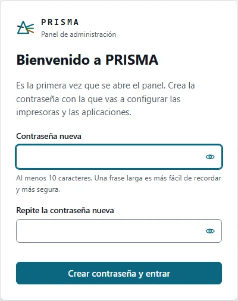
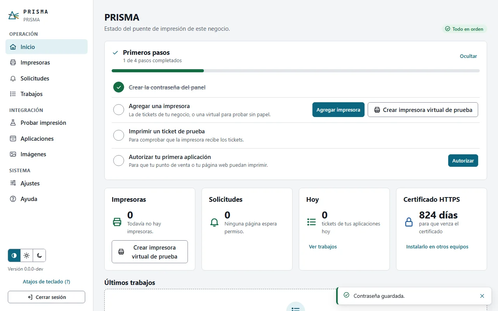
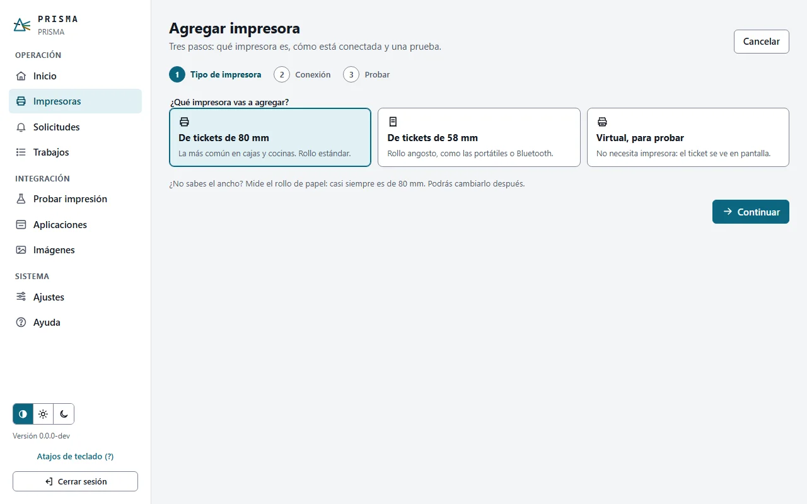
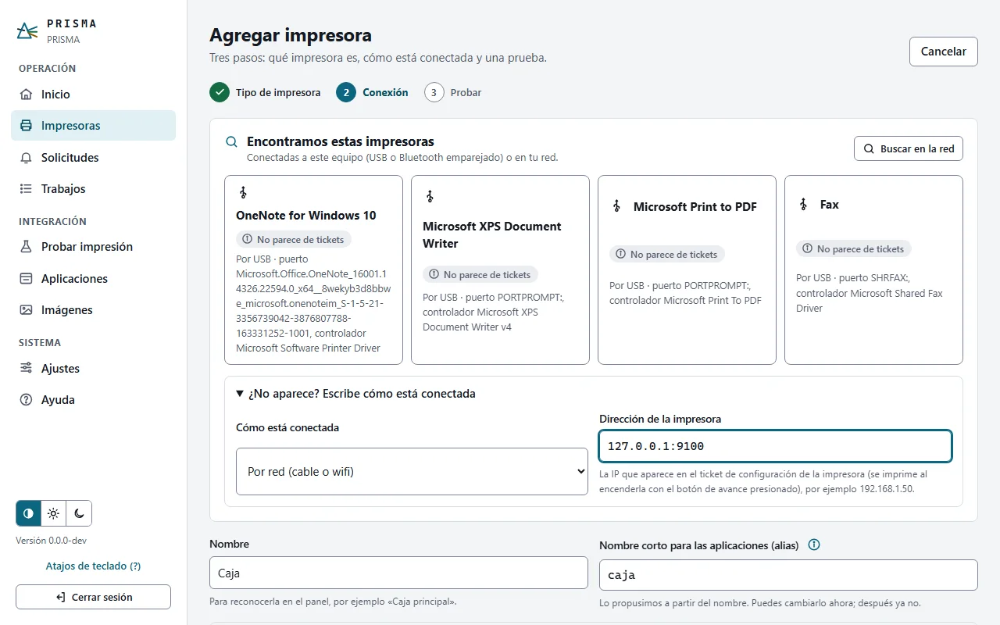
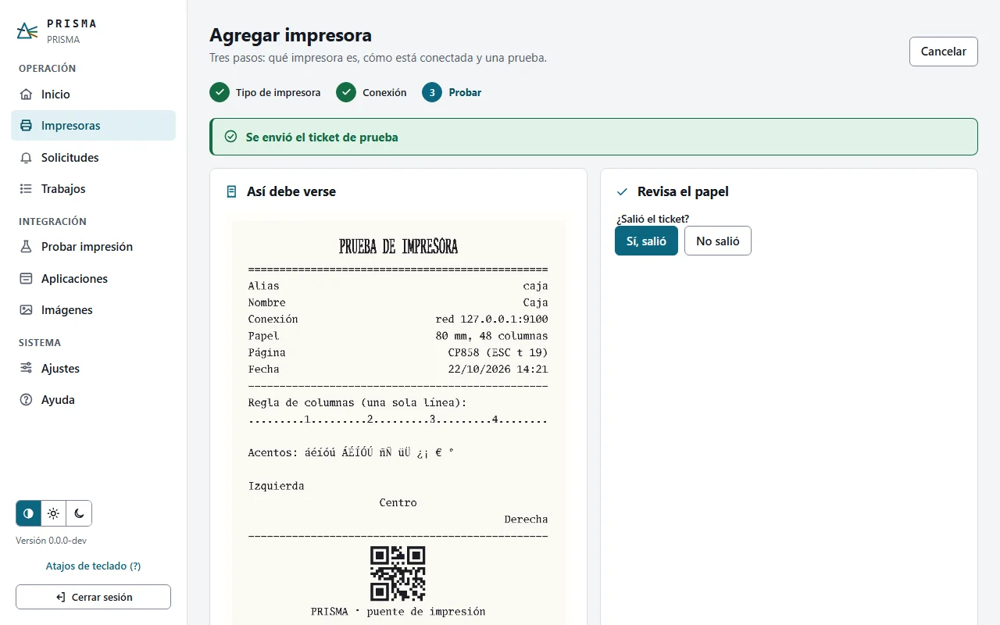
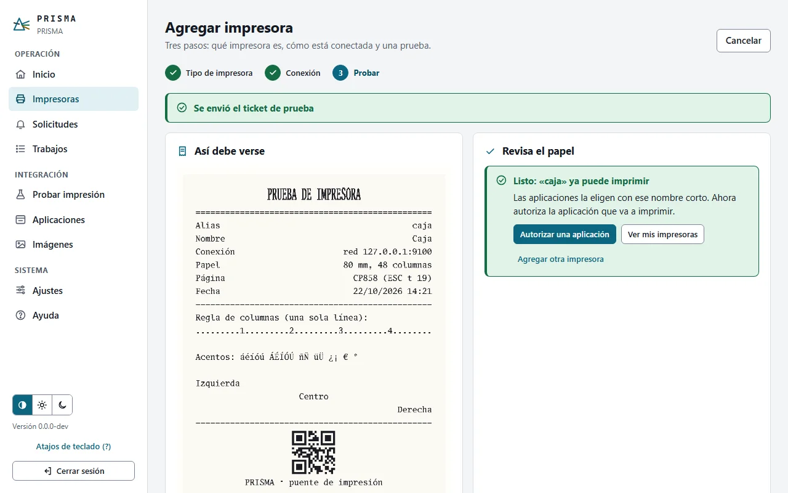
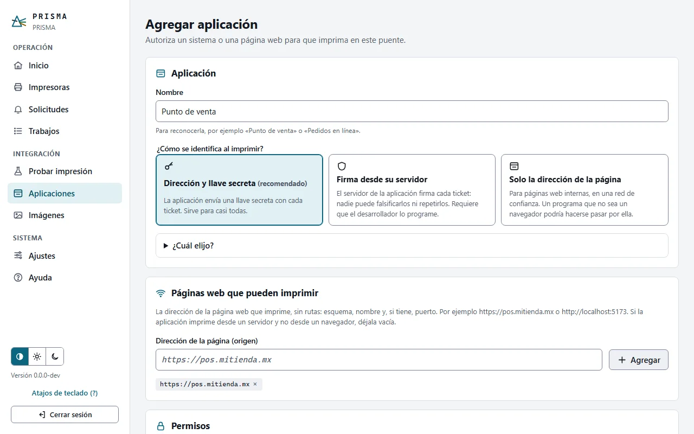
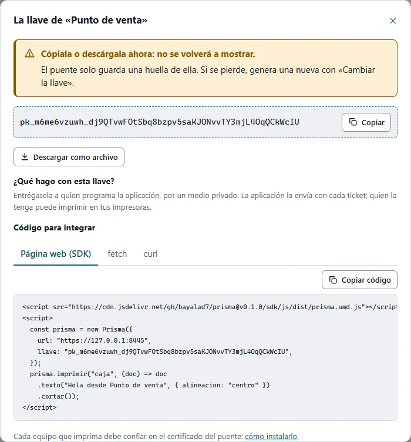
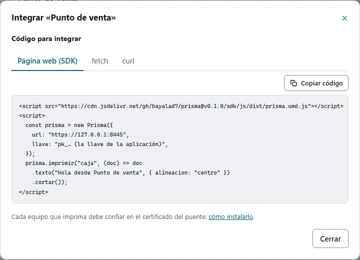
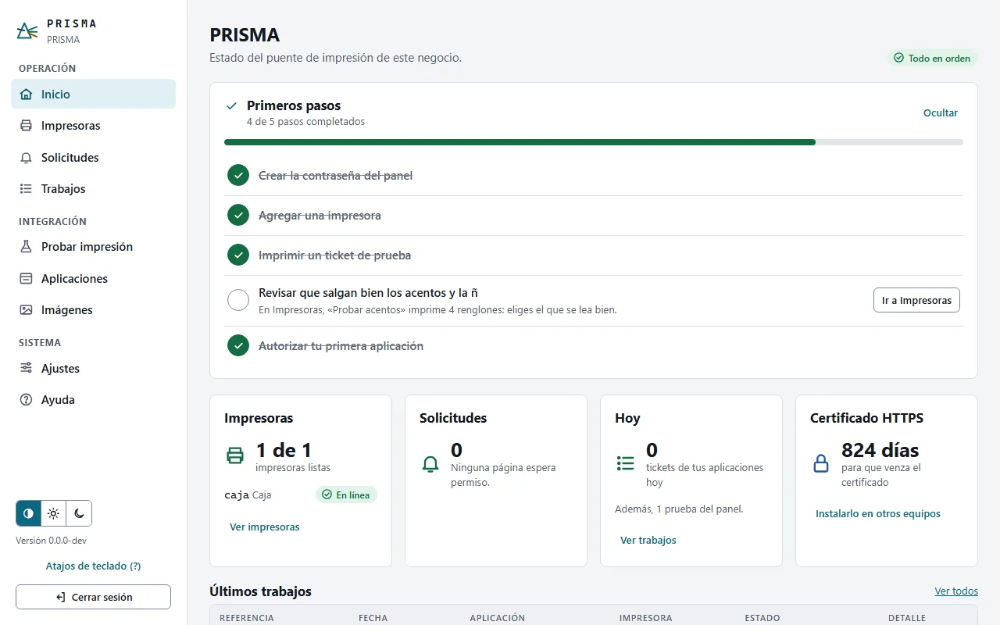

# Primeros pasos

De PRISMA recién instalado a imprimir tu primer ticket y autorizar la aplicación de tu negocio. Son cinco pasos y unos cinco minutos. No necesitas saber programar: lo técnico lo hace quien programa tu punto de venta, con lo que le entregues al final.

Antes de empezar, PRISMA debe estar instalado en el equipo que se queda encendido en el negocio ([Instalar PRISMA](../instalacion/README.md)), y la impresora de tickets encendida, con papel y conectada a ese equipo o a la red. ¿Todavía no tienes la impresora? Usa una impresora virtual: [Probar sin impresora](probar-sin-impresora.md).

## 1. Abre el panel y crea la contraseña

En el equipo donde instalaste PRISMA, abre el navegador en `https://localhost:8443/admin`. El instalador hizo que ese equipo confíe en el certificado del puente, así que no hay advertencia. Si el navegador avisa que «la conexión no es privada» (por ejemplo, porque actualizaste desde 0.2.0, o en Linux con Chrome), continúa con *Configuración avanzada → Continuar* y revisa *Ajustes → HTTPS*, o instala el certificado como explica [HTTPS y certificados](../instalacion/https-y-certificados.md#confiar-en-el-certificado).

Crea la contraseña del panel: al menos 10 caracteres. Una frase es más fácil de recordar y más segura.

Si abres el panel desde otro equipo, te pedirá además un código de un solo uso; lo muestra `prisma admin codigo-inicial` en el equipo del puente ([Primer acceso](README.md#primer-acceso)).

## 2. Sigue los «Primeros pasos» del Inicio

El Inicio muestra lo que falta para que el puente quede listo, con un botón para cada paso. Lo marca solo a medida que avanzas, y lo verás igual desde cualquier equipo.

## 3. Agrega la impresora

*Agregar impresora* te guía en tres pasos:

1. **Tipo:** de tickets de 80 mm (la más común), de 58 mm, o virtual para probar sin papel. ¿No sabes el ancho? Mide el rollo.

   

2. **Conexión y nombre:** elige tu impresora de la lista de las que encontró el puente. Si no aparece, *¿No aparece?* te deja escribir cómo está conectada: por red, la IP que imprime la impresora en su ticket de configuración; por USB, su nombre en el equipo. Ponle un nombre («Caja»): el panel propone el **nombre corto** (`caja`) con el que las aplicaciones la elegirán.

   

3. **Prueba:** el puente imprime un ticket de prueba y te muestra cómo debe verse. Confirma que salió y que los acentos se leen bien.

   

Si salen símbolos raros en lugar de los acentos, pulsa *No, salen símbolos raros*: el puente imprime cuatro renglones y eliges el que se lee bien. Si el ticket no sale, el panel te dice qué revisar ([La impresora no imprime](problemas-comunes.md#la-impresora-no-imprime)).

## 4. Autoriza la aplicación que va a imprimir

Ninguna página ni programa puede imprimir sin tu permiso. En *Aplicaciones → Agregar aplicación*:

1. Escribe su nombre («Punto de venta»).
2. Deja el nivel recomendado, *Dirección y llave secreta*.
3. Escribe la dirección de la página que va a imprimir, tal como aparece en el navegador (por ejemplo `https://pos.mitienda.mx`) y pulsa *Agregar*. Si no la sabes, pregúntale a quien programa la aplicación.
4. Pulsa *Crear aplicación*.

El panel muestra la **llave** de la aplicación una sola vez. Cópiala o descárgala y entrégasela a quien programa la aplicación por un medio privado.

¿La página ya intentó imprimir? Entonces aparece en *Solicitudes*, y basta con aprobarla ([Solicitudes de origen](aplicaciones-y-solicitudes.md#solicitudes-de-origen)).

## 5. Entrega el código a quien programa

En la tarjeta de la aplicación, *Código para integrar* tiene el ejemplo listo para copiar, con la dirección del puente y el nombre corto de la impresora. Con eso, quien programa tu punto de venta puede imprimir en minutos ([Integrar PRISMA en tu aplicación](../integradores/README.md)).

Listo: el Inicio muestra los pasos completos y la impresora en línea.

## Y después

- Cada equipo o celular desde el que se imprima debe confiar en el certificado del puente: [Confiar en el certificado](../instalacion/https-y-certificados.md#confiar-en-el-certificado).
- Descarga un respaldo en *Ajustes → Respaldo* ([Respaldo y restauración](../operacion/respaldo-y-restauracion.md)).
- Las palabras que usa el panel están en [Conceptos básicos](conceptos.md); las tareas de todos los días, en [Tareas frecuentes](tareas-frecuentes.md).

Las capturas se generan con [`img/primeros-pasos/capturar.mjs`](img/primeros-pasos/capturar.mjs).
