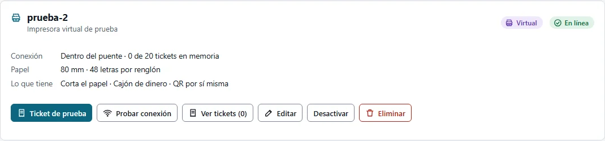
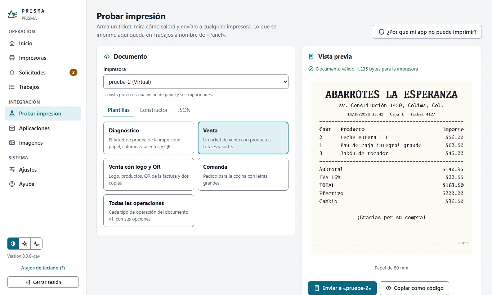
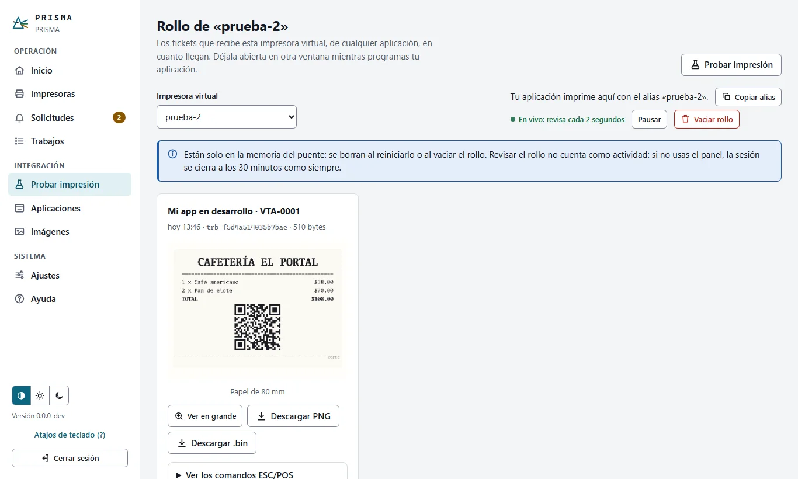
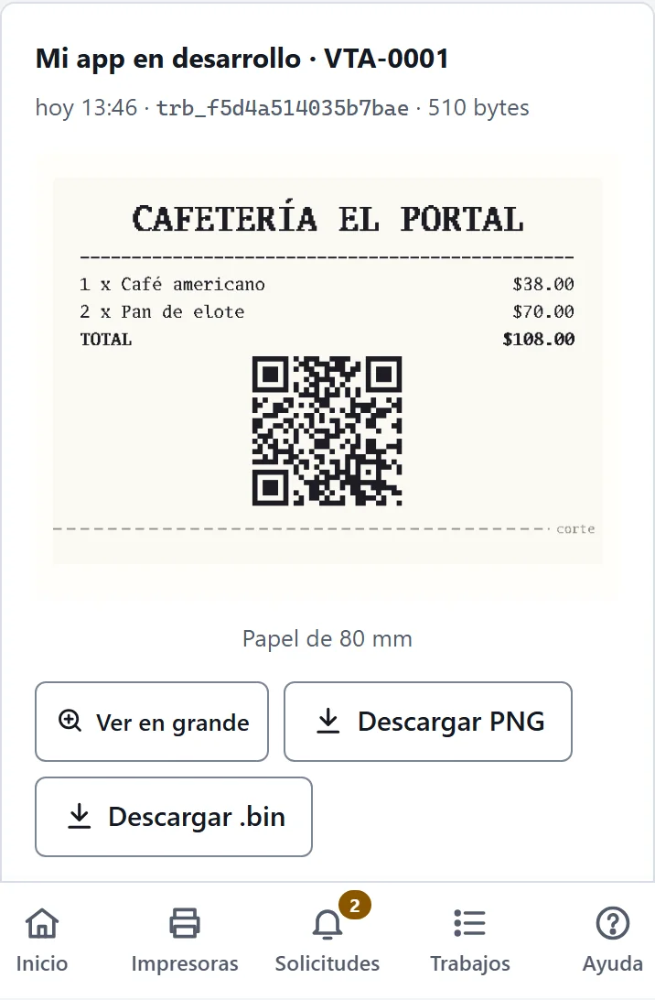
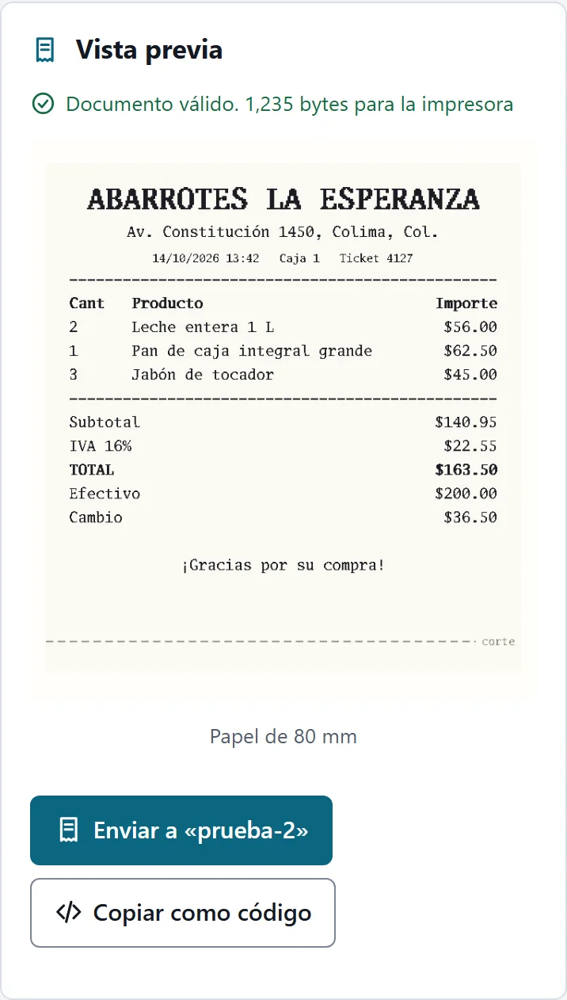

# Probar sin impresora

Con una **impresora virtual** puedes probar PRISMA de principio a fin sin papel: recibe los tickets igual que una impresora de verdad y los muestra en el panel tal como saldrían. Sirve al dueño del negocio, para ver el puente funcionando antes de tener la impresora, y a quien programa una aplicación, para probarla sin hardware.

## Lo que prueba y lo que no

| Prueba | No prueba |
|---|---|
| Que el ticket se arma bien: textos, columnas, acentos, QR, códigos de barras, imágenes y corte, con el ancho y las capacidades de la impresora. | El cable, la red o el Bluetooth hasta la impresora. |
| Que una aplicación está autorizada (origen, llave o firma) y puede usar esa impresora. | Que haya papel o que la tapa esté cerrada. |
| Cómo responde tu aplicación cuando algo falla (con la simulación). | Que la impresora física entienda la página de códigos elegida. |

La impresora virtual recibe exactamente los mismos bytes que recibiría una de papel con el mismo perfil ([diagrama 29](../diagramas/29-impresora-virtual.md)). Cuando conectes la impresora real, imprime su *Ticket de prueba* y usa *Probar acentos* ([impresoras.md](impresoras.md#diagnóstico-y-páginas-de-códigos)).

{{diagrama:29-impresora-virtual}}

## Para el dueño del negocio

1. **Crea la impresora virtual.** En *Impresoras → Agregar impresora*, elige **Virtual, para probar**: el asistente propone el nombre y el alias `prueba`. Si todavía no hay ninguna impresora, el botón **Crear impresora virtual de prueba** (en *Impresoras* y en *Primeros pasos* del Inicio) la crea en un clic.
2. **Imprime un ticket de prueba.** En su tarjeta, *Ticket de prueba* lo envía y lo muestra al momento.
3. **Prueba un ticket de verdad.** En *Probar impresión* elige una plantilla (venta, comanda…) y mira la vista previa. *Enviar a «prueba»* lo imprime en la virtual.
4. **Mira lo que recibió.** *Ver tickets* abre su rollo: cada ticket con la hora, quién lo envió y cómo salió.

## Para quien programa una aplicación

1. **Pide los datos al dueño** (o créalos tú si tienes acceso al panel): la aplicación autorizada en *Aplicaciones*, su llave si es de nivel 2 y el alias de la impresora virtual. Para tu aplicación es una impresora más: en `GET /v1/impresoras` aparece con `"virtual": true`.
2. **Abre el rollo en otra ventana.** En la tarjeta de la impresora, *Ver tickets*, o directamente `/admin/pruebas/rollo/prueba`. Cada ticket que envíe tu aplicación aparece solo, con su `trabajo_id`, la referencia y las advertencias explicadas. Puedes verlo en grande, descargar la imagen o los bytes exactos (`.bin`, para `prisma dev decodificar`) y ver los comandos ESC/POS.
3. **Imprime desde tu aplicación** con el SDK o con `POST /v1/imprimir`, como lo harías con la impresora real ([inicio-rapido.md](../integradores/inicio-rapido.md)).
4. **¿No imprime?** *Probar impresión → ¿Por qué mi app no puede imprimir?* (o *Comprobar permisos* en la aplicación) recorre la autorización sin imprimir y dice en qué paso fallaría y cómo resolverlo ([aplicaciones-y-solicitudes.md](aplicaciones-y-solicitudes.md)).
5. **Copia el código.** En *Probar impresión*, arma el ticket con el constructor o en JSON y pulsa *Copiar como código*: te da el mismo ticket con el SDK de JavaScript y con curl.

### Simular fallas

Al editar la impresora virtual, *Simulación* hace que responda como una impresora con problemas, con los códigos que la API ya informa:

| Simulación | Qué recibe tu aplicación |
|---|---|
| Normal | `ok: true`. |
| Fuera de línea | `503 IMPRESORA_INALCANZABLE` en cada ticket (y en *Probar conexión*). |
| Lenta | `ok: true`, después del retraso indicado (hasta 30 s): sirve para ver la cola y los tiempos de espera. |
| Falla aleatoria | `503 IMPRESORA_INALCANZABLE` en el porcentaje de tickets indicado. |

Un ticket que falla no queda en el rollo y su `id` queda libre: tu aplicación puede reintentarlo con el mismo documento sin que salga dos veces ([24-idempotencia.md](../diagramas/24-idempotencia.md)).

## Privacidad

Los tickets de una impresora virtual se guardan **solo en la memoria del puente**, para mostrarlos en el panel: los últimos 20 (de 1 a 200, al editarla) y como mucho 16 MB por impresora. Nunca van a la base de datos, la bitácora ni los respaldos, y se borran al reiniciar el puente o con *Vaciar rollo*. Las impresoras de papel no guardan nada del contenido.

El rollo se actualiza cada 2 segundos mientras lo ves, pero eso no cuenta como actividad: si no usas el panel, la sesión se cierra a los 30 minutos como siempre.

## En el celular

El rollo y *Probar impresión* funcionan igual en el celular: la vista previa queda debajo del documento.

 

Las capturas se generan con [`img/probar-sin-impresora/capturar.mjs`](img/probar-sin-impresora/capturar.mjs).
