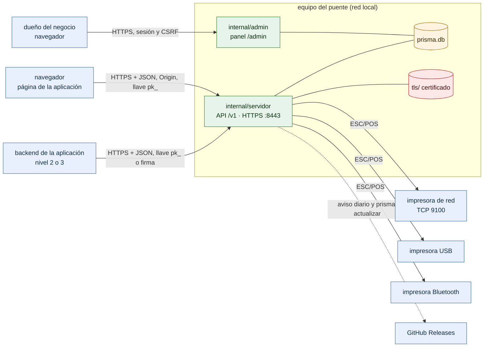

# Contexto del sistema

¿Quién habla con el puente y por dónde? Para cualquiera que llega a PRISMA por primera vez: dueños, instaladores, integradores y auditores.

- **No hay servidor de certificados remoto.** El certificado lo genera el propio puente (`autofirmado`) o lo entrega el dueño en archivos (`archivos`); ver [12-modos-tls.md](12-modos-tls.md). PRISMA 0.1.0 no descarga certificados de ningún servidor.
- La única conexión saliente es a GitHub Releases: una consulta diaria desactivable y `prisma actualizar`, que el dueño ejecuta. Imprimir no depende de Internet.
- El panel y la API comparten puerto: `internal/servidor` reparte `/admin` a `internal/admin`.
- Las aplicaciones nunca hablan con las impresoras: solo conocen su alias.

**Fuentes en el código:**

- internal/servidor/servidor.go (`Handler`)
- internal/servidor/escuchar.go
- internal/admin/admin.go
- internal/conector/
- internal/actualizacion/actualizacion.go

**Última verificación:** PRISMA 0.1.0 (rama `develop`, commit `5f67e19`), 22 de octubre de 2026.
