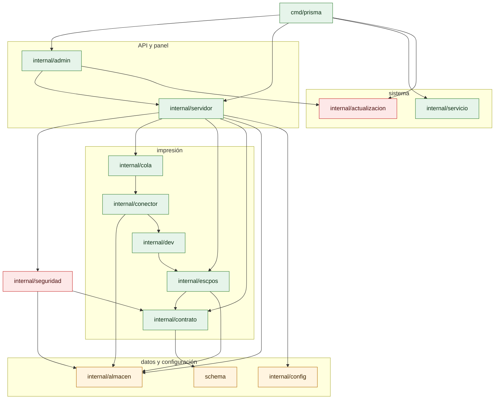

# Componentes y dependencias

¿Qué paquete depende de cuál? Para quien desarrolla o revisa el código. Solo se dibujan dependencias entre paquetes del proyecto, según `go list ./...`.

- Para no pasar de 15 nodos se omiten `internal/rutas` (lo usa solo `internal/config`) e `internal/version` (sin dependencias; lo usa `cmd/prisma`).
- `cmd/prisma` también importa directamente casi todos los paquetes; se dibujan solo las aristas que explican la estructura.
- `internal/admin` importa además `cola`, `conector`, `config`, `contrato`, `dev`, `escpos`, `seguridad` y `almacen`, igual que `internal/servidor`; se omiten para no duplicar flechas.
- `internal/conector` depende de `internal/dev` solo por la vista previa del conector de archivo.
- La tabla completa está en [arquitectura/componentes.md](../arquitectura/componentes.md).

**Fuentes en el código:**

- `go list -f '{{.ImportPath}} {{.Imports}}' ./...`
- cmd/prisma/
- internal/
- schema/

**Última verificación:** PRISMA 0.1.0 (rama `develop`, commit `5f67e19`), 22 de octubre de 2026.
