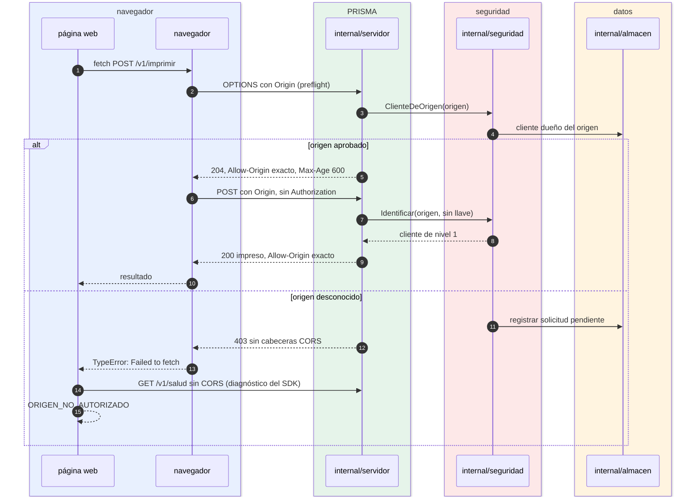

# Imprimir en el nivel 1 (origen)

¿Qué intercambian el navegador y el puente cuando una página sin llave imprime? Para integradores que publican una página web sin backend.

- El navegador envía `Origin` y no deja que la página lo cambie; por eso el nivel 1 protege contra páginas maliciosas, pero no contra curl.
- Con un origen desconocido el puente responde 403 **sin** CORS: la página no puede leer la respuesta y solo ve un error de red. El SDK lo distingue pidiendo `/v1/salud` sin CORS: si el puente responde, el problema es el origen.
- El origen desconocido ya quedó en *Solicitudes* del panel, tanto por el preflight como por la petición.
- Los pasos posteriores (validación, render, cola) son los de [03-flujo-impresion.md](03-flujo-impresion.md).

**Fuentes en el código:**

- internal/servidor/servidor.go (`preflight`, `permitirCORS`)
- internal/seguridad/autorizacion.go (`ClienteDeOrigen`, `Identificar`)
- internal/almacen/solicitudes.go (`Registrar`)
- sdk/js/src/prisma.mjs (`_diagnosticarNavegador`)

**Última verificación:** PRISMA 0.1.0 (rama `develop`, commit `5f67e19`), 22 de octubre de 2026.
