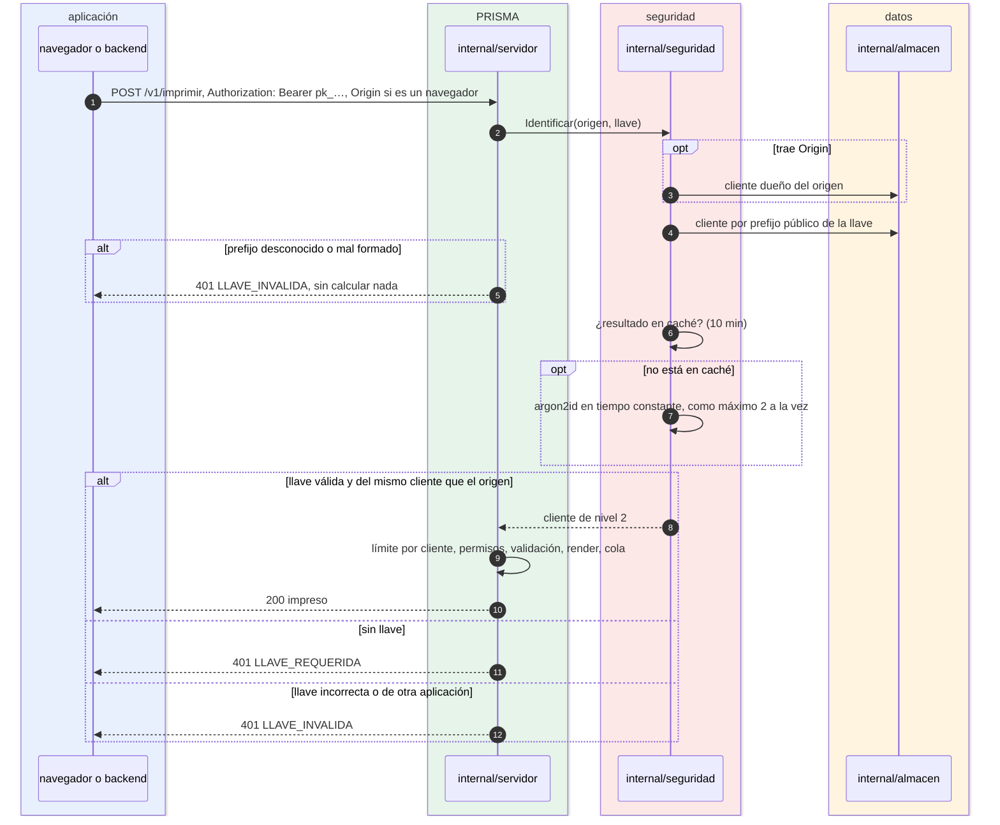

# Imprimir en el nivel 2 (llave)

¿Cómo se comprueba la llave `pk_` de una aplicación? Para integradores con página o backend que usan el nivel por defecto.

- Desde un servidor no hay `Origin`: la llave sola identifica al cliente.
- Una llave cuyo prefijo no existe se rechaza **sin** calcular argon2id; el resultado, válido o no, queda en caché 10 minutos. Así una lluvia de llaves inventadas no satura el equipo.
- Si viene `Origin`, la llave debe ser de la **misma** aplicación dueña de ese origen.
- Una llave revocada en el panel responde `LLAVE_REQUERIDA` hasta que se genere otra.

**Fuentes en el código:**

- internal/seguridad/autorizacion.go (`Identificar`, `verificarLlave`, `turnos`, `cache`)
- internal/seguridad/llaves.go
- internal/almacen/clientes.go
- internal/servidor/api.go (`identificar`, `limitarCliente`)

**Última verificación:** PRISMA 0.1.0 (rama `develop`, commit `5f67e19`), 22 de octubre de 2026.
