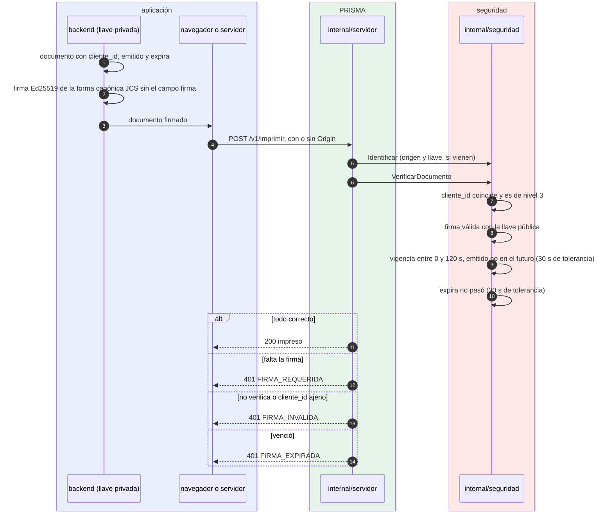

# Imprimir en el nivel 3 (firma)

¿Quién firma qué, y qué comprueba el puente? Para integradores con backend que necesitan que el ticket no se pueda alterar ni repetir.

- El puente solo guarda la llave **pública**: una base filtrada no permite falsificar documentos.
- Sin `Origin` ni llave, el cliente se identifica por el `cliente_id` del documento firmado.
- Un cliente de nivel 3 puede exigir también su llave `pk_` (`exigir_llave`); sin ella responde `LLAVE_REQUERIDA`.
- La repetición la frena la idempotencia: el mismo `id` no se imprime dos veces en 10 minutos ([24-idempotencia.md](24-idempotencia.md)).
- La guía para implementarlo: [integradores/firmar-documentos.md](../integradores/firmar-documentos.md).

**Fuentes en el código:**

- internal/seguridad/autorizacion.go (`VerificarDocumento`)
- internal/seguridad/firma.go (`VerificarFirma`, JCS)
- internal/contrato/reglas.go (`VigenciaMaxima`)
- sdk/firmadores/
- testdata/vector-firma/

**Última verificación:** PRISMA 0.1.0 (rama `develop`, commit `5f67e19`), 22 de octubre de 2026.
