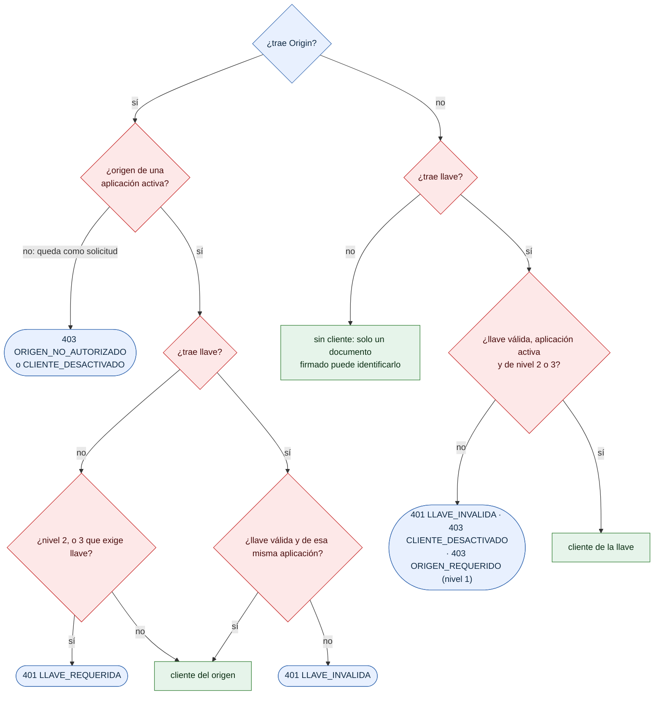

# Identificación del cliente, en detalle

¿Cómo combina el puente `Origin` y la llave para saber qué aplicación envía la petición? Detalle del segundo paso de [07-orden-autorizacion.md](07-orden-autorizacion.md), para integradores y auditores.

- `ORIGEN_REQUERIDO` aparece cuando llega, sin `Origin`, la llave de una aplicación de nivel 1: ese nivel solo vale desde un navegador.
- Con `Origin` y llave, la llave debe pertenecer a la aplicación dueña del origen; si es de otra, `LLAVE_INVALIDA`.
- *Sin cliente* no es un rechazo todavía: el paso de firma identifica al cliente por el `cliente_id` de un documento firmado, o responde `CREDENCIALES_REQUERIDAS`.

**Fuentes en el código:**

- internal/seguridad/autorizacion.go (`Identificar`, `ClienteDeOrigen`, `verificarLlave`, `desactivado`)

**Última verificación:** PRISMA 0.1.0 (rama `develop`, commit `5f67e19`), 22 de octubre de 2026.
