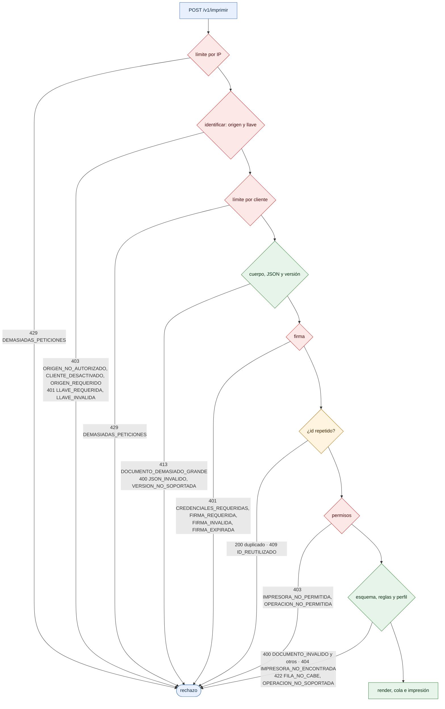

# Orden de autorización y validación

¿En qué orden comprueba el puente una petición, y con qué código rechaza en cada paso? Para integradores que depuran un error y para auditores.

- El puente se detiene en el primer paso que falla. El orden garantiza que nada costoso ocurra antes de saber quién envía el documento.
- *Rechazo* agrupa todas las salidas; el borde dice el estado HTTP y el código. «200 duplicado» no es un error: responde el trabajo original sin imprimir.
- `CREDENCIALES_REQUERIDAS` sale en el paso de firma: si no hubo origen ni llave, solo un documento firmado puede identificar al cliente.
- El detalle de la identificación está en [07-orden-autorizacion-detalle.md](07-orden-autorizacion-detalle.md). Los errores de impresión (503, 504) están en [23-diagnostico-problemas.md](23-diagnostico-problemas.md).
- Todos los códigos: [referencia/codigos-de-error.md](../referencia/codigos-de-error.md).

**Fuentes en el código:**

- internal/servidor/api.go (`autorizarDocumento`, `imprimir`, `responderSiRepetido`)
- internal/servidor/servidor.go (`limitarIP`, `ResponderError`)
- internal/seguridad/autorizacion.go
- internal/contrato/validar.go (`LeerSobre`, `Decodificar`)

**Última verificación:** PRISMA 0.1.0 (rama `develop`, commit `5f67e19`), 22 de octubre de 2026.
