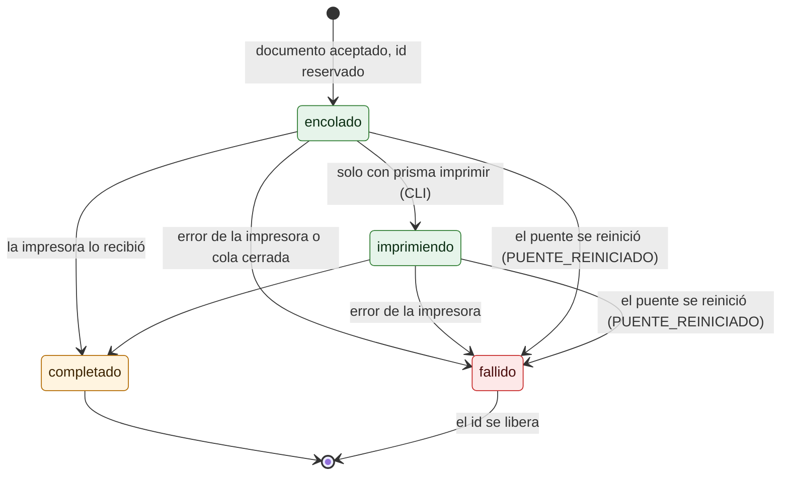

# Ciclo de vida de un trabajo

¿Por qué estados pasa un trabajo y cuándo se libera su `id`? Para quien soporta o integra y lee el historial de *Trabajos*.

- **En 0.1.0, los trabajos de la API no pasan por `imprimiendo`.** La cola del servicio no registra `AlIniciar`, así que van directo de `encolado` a `completado` o `fallido`. Solo `prisma imprimir` (modo desarrollo) marca `imprimiendo`. Es la discrepancia D-22 del [plan](../PLAN-DOCUMENTACION.md).
- `completado` puede llevar advertencias, por ejemplo `IMPRESORA_FUERA_DE_LINEA` con Confirmar impresión: el ticket llegó y no debe reenviarse.
- Un `fallido` libera su `id`, así que el reintento de la aplicación se imprime ([24-idempotencia.md](24-idempotencia.md)).
- `PUENTE_REINICIADO` lo pone `MarcarInterrumpidos` al arrancar, en la misma transacción que libera los `id`.
- El historial se borra pasados los días de retención (30 por defecto).

**Fuentes en el código:**

- internal/almacen/trabajos.go (`Crear`, `MarcarImprimiendo`, `Finalizar`, `MarcarInterrumpidos`)
- internal/servidor/api.go (`finalizar`)
- cmd/prisma/ejecutar.go
- cmd/prisma/imprimir.go

**Última verificación:** PRISMA 0.1.0 (rama `develop`, commit `5f67e19`), 22 de octubre de 2026.
