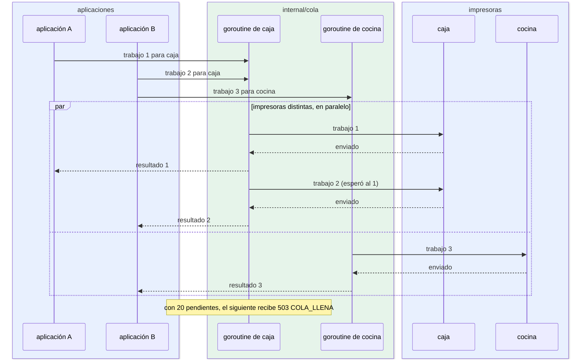

# Cola por impresora

¿Qué pasa cuando dos aplicaciones imprimen a la vez, en la misma impresora y en impresoras distintas? Para integradores y desarrolladores que razonan sobre tiempos y concurrencia.

- Cada impresora tiene **una goroutine**: imprime en orden de llegada (FIFO) y de a un trabajo. Así dos tickets nunca se mezclan en el papel.
- Impresoras distintas trabajan en paralelo.
- El límite de 20 cuenta los que esperan más el que se imprime; el siguiente recibe `COLA_LLENA` con `Retry-After`.
- Cada trabajo tiene como máximo 60 s. Si la aplicación espera más de 60 s su turno, recibe 202 y el trabajo se imprime igual.
- La misma goroutine prueba la impresora cada 30 s cuando no imprime ([26-estados-impresora.md](26-estados-impresora.md)).

**Fuentes en el código:**

- internal/cola/cola.go (`Registrar`, `Encolar`, `atender`, `imprimir`, `MaxPorImpresora`, `TiempoTrabajo`)
- internal/servidor/api.go (`TiempoRespuesta`)

**Última verificación:** PRISMA 0.1.0 (rama `develop`, commit `5f67e19`), 22 de octubre de 2026.
