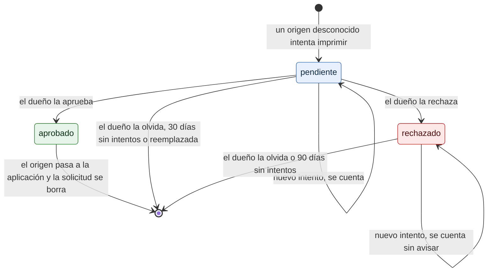

# Solicitudes de origen

¿Qué pasa con un origen desconocido que intenta imprimir? Para el dueño que revisa *Solicitudes* y para quien audita que la lista no se pueda llenar.

- *Aprobar* crea una aplicación nueva (nivel 1 o 2) o agrega el origen a una existente; la fila de la solicitud se borra en la misma transacción.
- La purga es horaria. Caben 200 solicitudes: un origen nuevo **reemplaza** a la pendiente con la actividad más antigua; si todas son rechazadas, el nuevo no se registra.
- Con más de 150, el panel muestra un aviso: muchos orígenes desconocidos suelen indicar que alguien está probando el puente.
- *Olvidar* la borra; si el origen vuelve a intentarlo, aparece de nuevo como pendiente.

**Fuentes en el código:**

- internal/almacen/solicitudes.go (`Registrar`, `Aprobar`, `Rechazar`, `Eliminar`, `Purgar`, `MaxSolicitudes`)
- internal/admin/clientes.go (`aprobarSolicitud`, `rechazarSolicitud`, `olvidarSolicitud`)
- cmd/prisma/ejecutar.go (`mantenimiento`)
- internal/seguridad/autorizacion.go (`ClienteDeOrigen`)

**Última verificación:** PRISMA 0.1.0 (rama `develop`, commit `5f67e19`), 22 de octubre de 2026.
