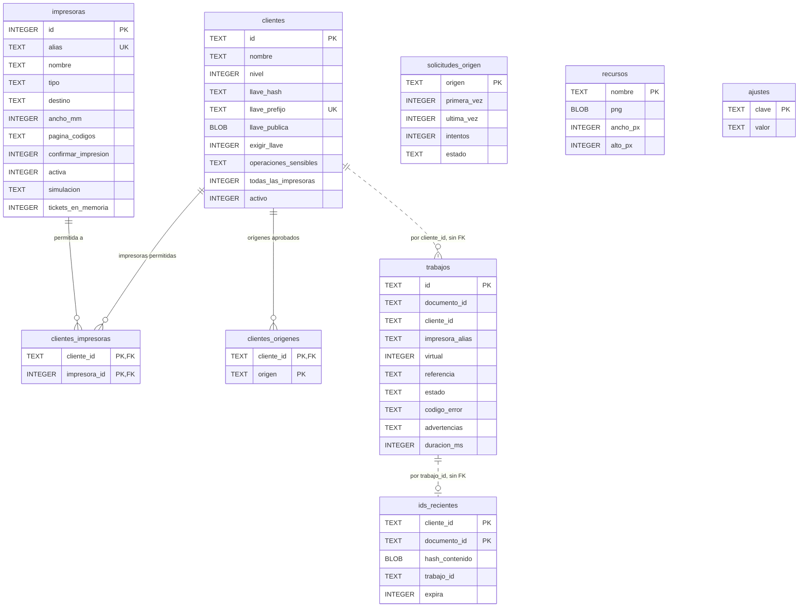

# Modelo de datos

¿Qué tablas tiene `prisma.db`, con qué llaves y cómo se relacionan? Para desarrolladores y para quien revisa qué datos guarda el puente.

- Las líneas continuas son claves foráneas reales (con borrado en cascada); las punteadas, referencias por valor **sin** clave foránea, a propósito: el historial se conserva aunque se borre la aplicación o la impresora, y `trabajos` guarda el alias, no el id de la impresora.
- `trabajos` **nunca** guarda el contenido del ticket. `ids_recientes` guarda solo el hash del contenido, 10 minutos.
- `ajustes` es clave-valor: contraseña del panel (hash), retención, límites, nombre del puente, acceso, código inicial (hash).
- Se omiten columnas secundarias (`creado`, `actualizado`, columnas y puntos del perfil). Los diagramas ER no admiten `classDef` en el render de GitHub, así que este no lleva colores.

**Fuentes en el código:**

- internal/almacen/migraciones/0001_inicial.sql
- internal/almacen/migraciones/0002_llaves_argon2id.sql
- internal/almacen/migraciones/0003_nivel2_sin_llave.sql
- internal/almacen/migraciones/0004_confirmar_impresion.sql
- internal/almacen/migraciones/0005_impresora_virtual.sql
- internal/almacen/ajustes.go

**Última verificación:** PRISMA 0.2.0 en desarrollo (rama `develop`), 22 de octubre de 2026.
