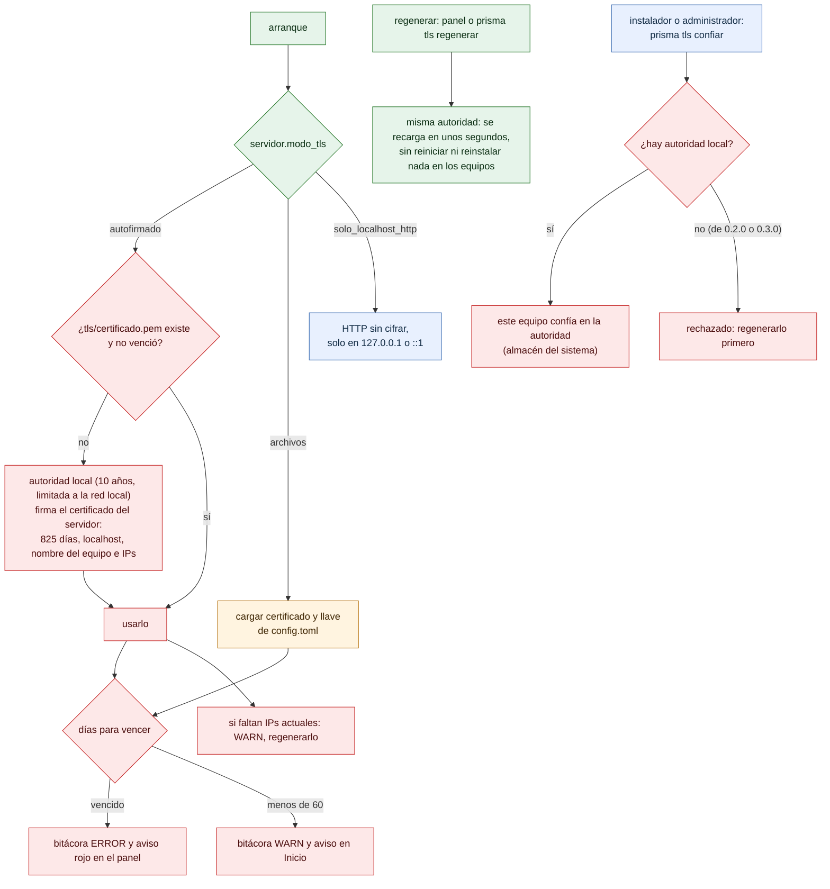

# Modos de TLS y ciclo del certificado

¿Qué hace el puente con HTTPS según `modo_tls`, y qué pasa con su certificado al arrancar y mientras corre? Para instaladores y administradores.

- **Solo existen tres modos.** No hay un modo «remoto» ni descarga de certificados desde un servidor en PRISMA 0.1.0: `config.Validar` rechaza cualquier otro valor de `modo_tls`. Por eso no hay diagrama de certificado remoto.
- Con `autofirmado`, un certificado vencido se **regenera al arrancar**; con `archivos`, el puente no puede renovarlo y solo avisa.
- `archivos` también se recarga en caliente: el puente vuelve a leer los archivos cada 5 s si cambian.
- Desde 0.3.1, una autoridad local firma el certificado del servidor ([ADR 0021](../adr/0021-autoridad-local-y-certificado-del-servidor.md)): regenerarlo conserva la autoridad, así que no hay que reinstalar nada en los equipos. Solo una autoridad nueva (cambió el nombre del equipo) obliga a instalarla de nuevo.
- `prisma tls confiar` solo confía en la autoridad local, limitada a la red local: aunque un equipo confíe en ella, su llave no sirve para ningún sitio de Internet ([ADR 0020](../adr/0020-confiar-en-el-certificado-del-puente-al-instalar.md)).

**Fuentes en el código:**

- internal/config/config.go (`TLSAutofirmado`, `TLSArchivos`, `TLSSoloLocalhostHTTP`, validación de `modo_tls`)
- internal/servidor/escuchar.go (`Escuchar`, `avisarVencimiento`)
- internal/servidor/tls.go (`CargarAutofirmado`, `NuevoArchivos`, `Vencimiento`, `IPsSinCubrir`)
- internal/admin/ajustes.go (`avisoCertificado`, `regenerarTLS`)
- internal/servicio/confianza.go (`ConfiarCertificado`, `QuitarConfianza`)
- cmd/prisma/tls.go

**Última verificación:** PRISMA 0.3.1 en desarrollo (rama `develop`), 26 de octubre de 2026.
