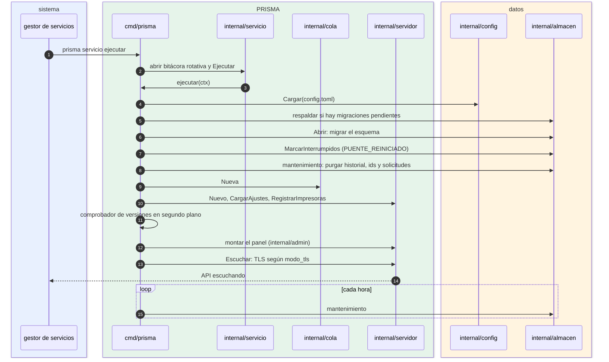

# Arranque del servicio

¿Qué hace el puente, en orden, desde que el sistema lo inicia hasta que acepta peticiones? Para desarrolladores y para quien diagnostica un servicio que no arranca.

- Si `ejecutar` termina con error sin que el sistema lo pida, el proceso sale con código 1 y el gestor lo reinicia a los 5 s.
- El respaldo antes de migrar ocurre **antes** de abrir la base: así la copia es del esquema viejo.
- `MarcarInterrumpidos` corre antes de aceptar peticiones: cuando una aplicación reintenta, el `id` ya está libre.
- `RegistrarImpresoras` crea una goroutine por impresora activa ([09-cola-por-impresora.md](09-cola-por-impresora.md)).
- Detener: el gestor cancela el contexto, el servidor cierra en hasta 10 s y la cola termina; si no termina en 20 s, se informa un error.
- En Linux la bitácora también va a journald; con `prisma ejecutar` (primer plano) va a la terminal.

**Fuentes en el código:**

- cmd/prisma/servicio.go (`nuevoComandoServicioEjecutar`)
- cmd/prisma/ejecutar.go (`ejecutar`, `mantenimiento`)
- internal/servicio/servicio.go (`Ejecutar`, `programa`)
- internal/servicio/rotativo.go
- internal/config/config.go (`Cargar`)
- internal/almacen/almacen.go (`Abrir`)
- internal/almacen/respaldo.go (`RespaldarSiHayMigraciones`)
- internal/servidor/escuchar.go

**Última verificación:** PRISMA 0.1.0 (rama `develop`, commit `5f67e19`), 22 de octubre de 2026.
