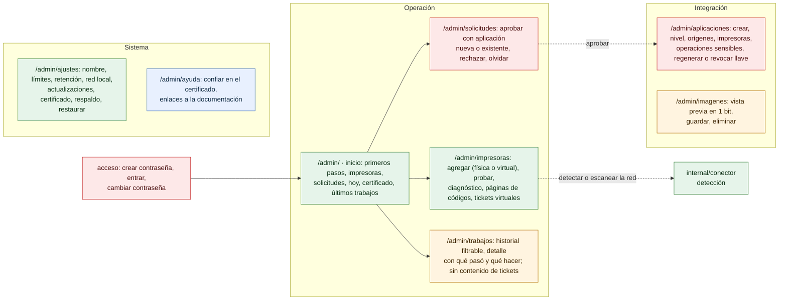

# Pantallas del panel

¿Qué pantallas tiene el panel y qué se puede hacer en cada una? Para el dueño del negocio y para soporte.

- La navegación agrupa las 8 secciones en *Operación*, *Integración* y *Sistema*; *Inicio* es la de entrada después de *acceso*. En celular, el menú se despliega y una barra inferior lleva a Inicio, Impresoras, Solicitudes (con el número de pendientes), Trabajos y Ayuda.
- Cada sección tiene su ruta: el puente sirve el panel en todas (`vistasPanel`) y `panel.js` dibuja la pantalla sin recargar; Atrás y Adelante funcionan. Los enlaces de 0.1.0 con `#` (`#clientes`, `#recursos`, `#impresoras`…) llevan a la ruta nueva.
- *Primeros pasos* sale de los datos del puente (impresoras, aplicaciones y las marcas `panel.primera_prueba` y `panel.acentos_probados`), así que se ve igual en cualquier equipo; ocultarla solo afecta al navegador.
- Atajos: `g` y la letra de la sección (por ejemplo `g p`, Impresoras); `?` los muestra y permite desactivarlos.
- *Acceso* es el primer acceso (con código desde otro equipo), el inicio de sesión y el cambio de contraseña obligatorio tras restablecerla ([16-panel-sesion.md](16-panel-sesion.md)).
- Toda acción usa la API interna `/admin/api/…`, con sesión y CSRF; no es una API pública.
- *Ayuda* enlaza la documentación de la versión instalada (`blob/v<versión>/docs/`).

**Fuentes en el código:**

- internal/admin/web/panel.js (`SECCIONES`, `HASH_VIEJOS`, `VISTAS`, `mostrarApp`, `vistaInicio`, `vistaAyuda`, `formularioImpresora`)
- internal/admin/web/sistema.js (`marco`)
- internal/admin/admin.go (`Handler`: rutas de `/admin/api`; `vistasPanel`)
- internal/admin/impresoras.go
- internal/admin/clientes.go
- internal/admin/ajustes.go

**Última verificación:** PRISMA 0.2.0 en desarrollo (rama `develop`), 22 de octubre de 2026.
