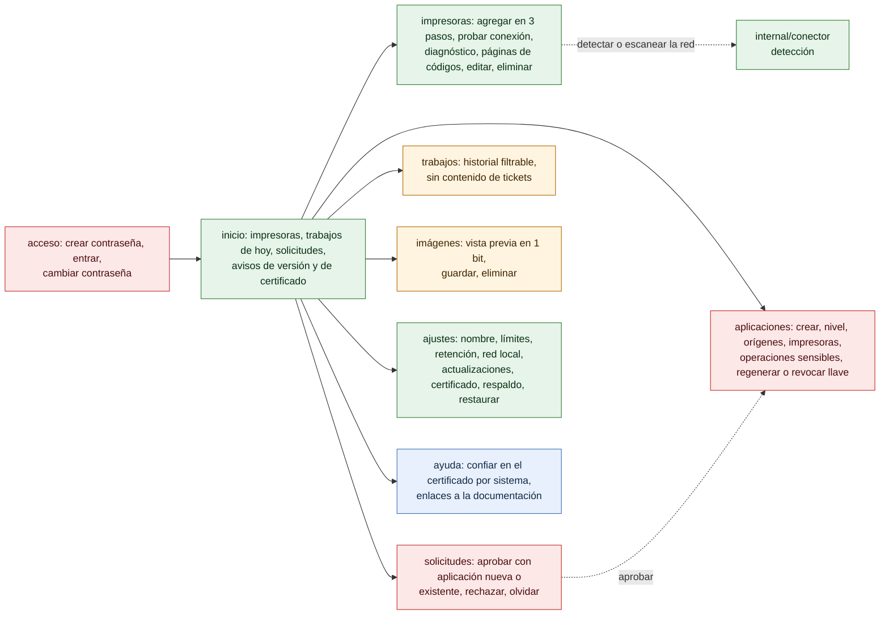

# Pantallas del panel

¿Qué pantallas tiene el panel y qué se puede hacer en cada una? Para el dueño del negocio y para soporte.

- La barra de navegación lleva las 8 secciones; *Inicio* es la de entrada después de *acceso*.
- *Acceso* es el primer acceso (con código desde otro equipo), el inicio de sesión y el cambio de contraseña obligatorio tras restablecerla ([16-panel-sesion.md](16-panel-sesion.md)).
- Toda acción usa la API interna `/admin/api/…`, con sesión y CSRF; no es una API pública.
- *Ayuda* enlaza la documentación de la versión instalada (`blob/v<versión>/docs/`).

**Fuentes en el código:**

- internal/admin/web/panel.js (`SECCIONES`, `VISTAS`, `vistaInicio`, `vistaAyuda`, `formularioImpresora`)
- internal/admin/admin.go (`Handler`: rutas de `/admin/api`)
- internal/admin/impresoras.go
- internal/admin/clientes.go
- internal/admin/ajustes.go

**Última verificación:** PRISMA 0.1.0 (rama `develop`, commit `5f67e19`), 22 de octubre de 2026.
