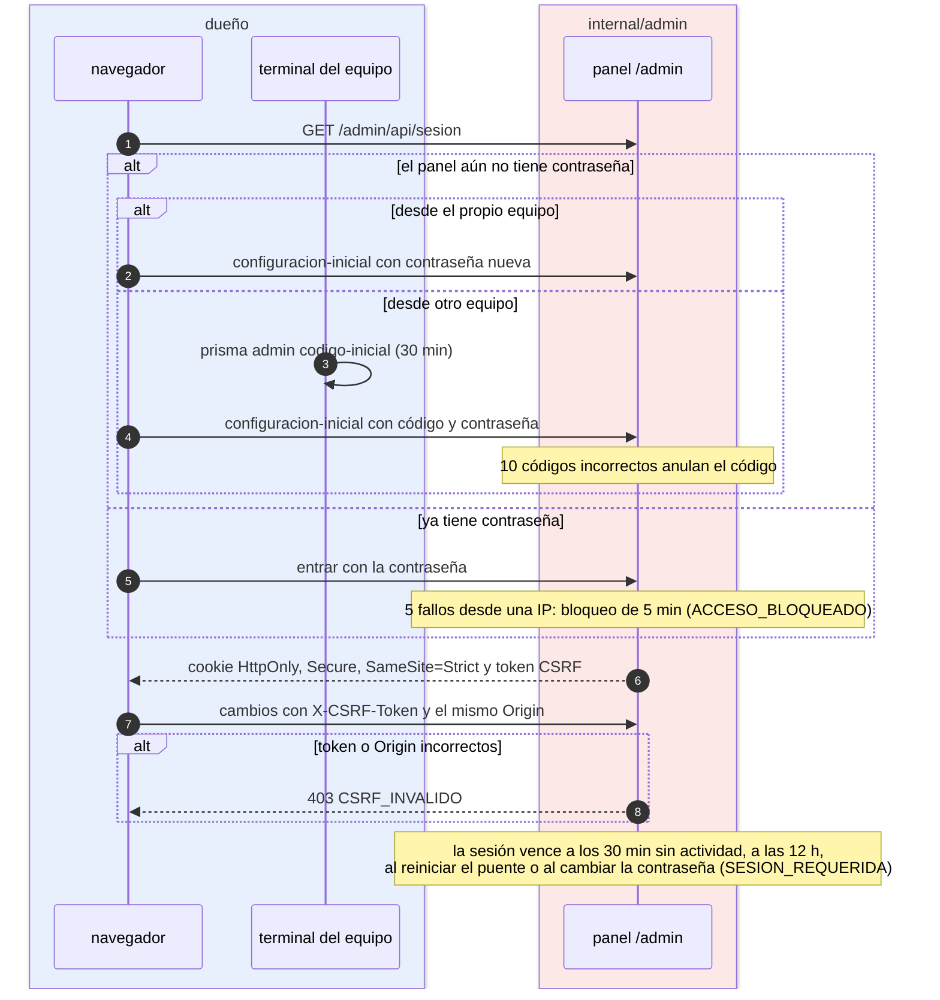

# Sesión del panel

¿Cómo se entra al panel y cómo se protege la sesión? Para administradores y auditores.

- Sin contraseña, solo el propio equipo puede configurar el panel sin código: nadie de la red se adueña de un puente recién instalado.
- La contraseña usa argon2id (64 MiB, 3 pasadas), con un solo cálculo a la vez.
- El token de sesión son 32 bytes aleatorios; el puente guarda su SHA-256, en memoria.
- Tras `prisma admin restablecer-contrasena`, toda acción responde `CAMBIO_DE_CONTRASENA_REQUERIDO` hasta que se cambie.
- Por defecto el panel solo responde a IPs privadas y al propio equipo (`ACCESO_SOLO_RED_LOCAL`).

**Fuentes en el código:**

- internal/admin/sesiones.go (`inactividadMaxima`, `duracionMaxima`, `fallosPermitidos`, `bloqueo`, `vigenciaCodigo`, `fallosCodigo`)
- internal/admin/admin.go (`Handler`, `redPermitida`)
- internal/seguridad/contrasena.go
- cmd/prisma/admin.go

**Última verificación:** PRISMA 0.1.0 (rama `develop`, commit `5f67e19`), 22 de octubre de 2026.
