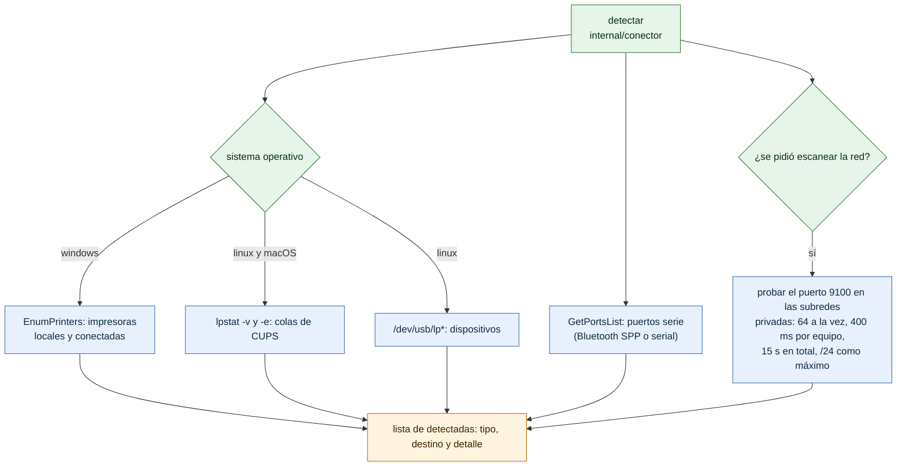

# Detección de impresoras

¿Cómo encuentra el puente las impresoras en cada sistema operativo? Para instaladores que agregan impresoras con el panel o con `prisma impresoras detectar`.

- La detección es igual en Linux y macOS (mismo archivo `usb_unix.go`); en macOS no suele haber `/dev/usb/lp*`, así que aparecen solo las colas de CUPS.
- Los puertos serie se listan en los tres sistemas: `COMn` en Windows, `/dev/rfcommN` o `/dev/ttyUSBN` en Linux y `/dev/cu.*` en macOS.
- El escaneo de red nunca es automático: solo con `--red` en la CLI o el botón del panel. Una subred mayor que /24 se reduce al /24 de este equipo.
- Detectar no agrega nada: el dueño elige la impresora y completa su perfil.

**Fuentes en el código:**

- internal/conector/deteccion.go (`Detectar`, `EscanearRed`, `SubredesLocales`)
- internal/conector/usb_windows.go (`impresorasSistema`, `impresorasWindows`)
- internal/conector/usb_unix.go (`impresorasSistema`)
- internal/admin/impresoras.go (`detectar`)
- cmd/prisma/impresoras.go

**Última verificación:** PRISMA 0.1.0 (rama `develop`, commit `5f67e19`), 22 de octubre de 2026.
