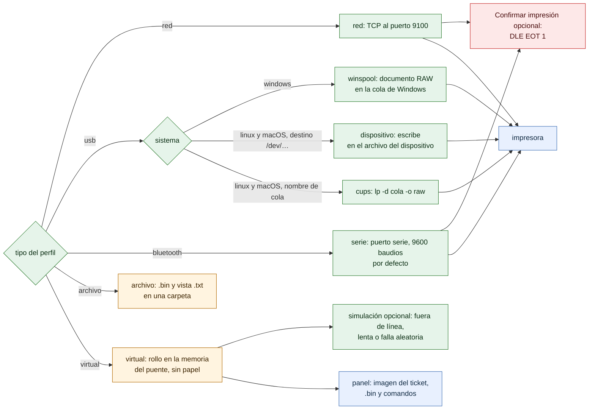

# Conectores

¿Qué conector usa cada tipo de impresora y por qué mecanismo llega a ella en cada sistema? Para instaladores y desarrolladores.

- Todos implementan `Conector{Enviar, Probar}`; `conector.Nuevo` elige según el tipo del perfil, y `nuevoUSB` existe en dos versiones por build tag (Windows y el resto).
- Red: 3 s para conectar y 10 s para escribir; reintenta una vez solo si no envió ningún byte.
- Winspool: si vence el plazo, cancela el trabajo con `AbortPrinter` ([25-confirmar-impresion.md](25-confirmar-impresion.md) explica por qué USB no confirma).
- Confirmar impresión solo existe en red y serie: winspool, CUPS y `/dev/usb` no devuelven la respuesta de la impresora.
- El conector de archivo es para desarrollo y auditoría: guarda los bytes exactos y su previsualización.
- El conector virtual vive dentro del puente: recibe los mismos bytes que una impresora física y los guarda solo en memoria (los últimos 20 por defecto, como mucho 16 MB por impresora) para que el panel los dibuje a 203 ppp. Un ticket que falla por la simulación no se guarda, y su `id` se libera como en cualquier trabajo fallido.

**Fuentes en el código:**

- internal/conector/conector.go (`Nuevo`)
- internal/conector/red.go
- internal/conector/serie.go
- internal/conector/usb_windows.go
- internal/conector/usb_unix.go (`nuevoUSB`, `Dispositivo`, `CUPS`)
- internal/conector/archivo.go
- internal/conector/virtual.go (`Virtual`, `Rollos`)
- internal/dev/raster.go (`Rasterizar`)

**Última verificación:** PRISMA 0.2.0 en desarrollo (rama `develop`), 22 de octubre de 2026.
