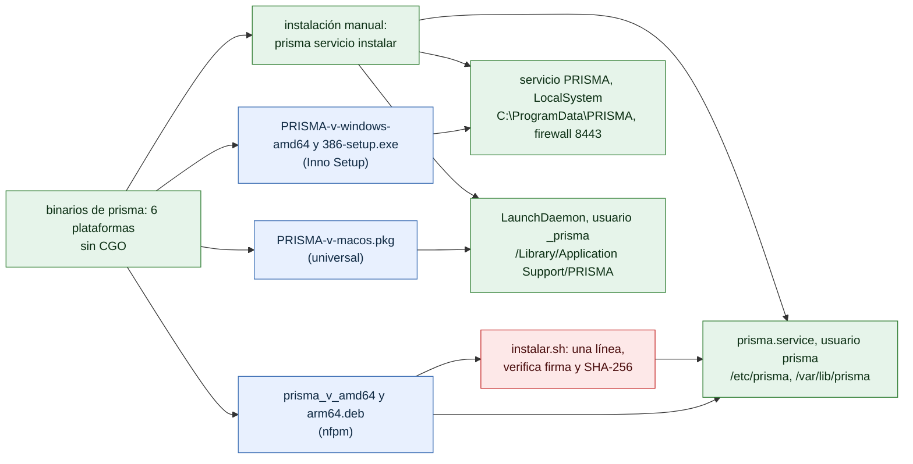

# Despliegue por plataforma

¿Qué se publica para cada sistema y cómo queda instalado el servicio? Para instaladores y para quien mantiene los paquetes.

- Los tres instaladores terminan en el mismo `internal/servicio`; `prisma servicio instalar` hace lo mismo sin instalador.
- La unidad de systemd del `.deb` es idéntica a la plantilla de `internal/servicio` (lo verifica una prueba).
- En Windows, las carpetas de datos y bitácoras quedan solo para SYSTEM y Administradores.
- Las rutas completas por sistema están en [operacion/README.md](../operacion/README.md#dónde-está-cada-cosa).

**Fuentes en el código:**

- internal/servicio/servicio.go
- internal/servicio/plantillas.go
- internal/servicio/sistema_windows.go
- internal/servicio/sistema_linux.go
- internal/servicio/sistema_darwin.go
- internal/rutas/
- empaquetado/windows/prisma.iss
- empaquetado/linux/
- empaquetado/macos/
- Makefile

**Última verificación:** PRISMA 0.1.0 (rama `develop`, commit `5f67e19`), 22 de octubre de 2026.
