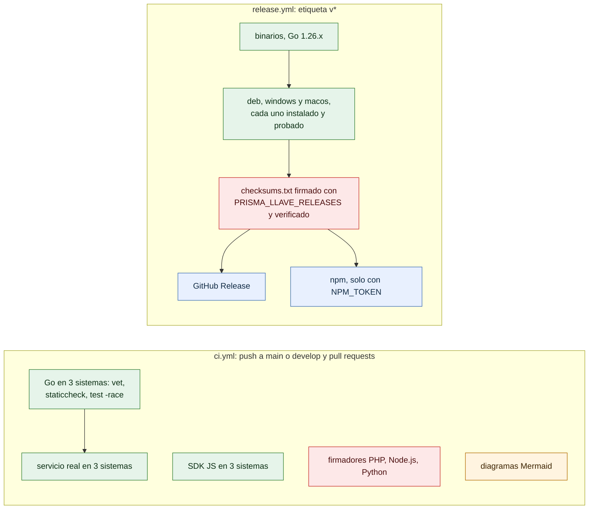

# Integración continua y publicación

¿Qué se comprueba en cada cambio y qué pasa al publicar una versión? Para quien mantiene el proyecto.

- `go test ./...` incluye las pruebas de la documentación (`go test ./docs`): rutas de la API, códigos de error y enlaces.
- El trabajo *diagramas* corre `scripts/validar-diagramas.sh`: si un bloque Mermaid no compila, el CI falla.
- El CI y la publicación usan el último parche de Go 1.26 (`go-version: '1.26.x'`), no el mínimo de `go.mod`.
- La publicación verifica la firma de `checksums.txt` contra la llave pública del repositorio **antes** de subir nada.

**Fuentes en el código:**

- .github/workflows/ci.yml
- .github/workflows/release.yml
- scripts/validar-diagramas.sh
- Makefile
- build.ps1

**Última verificación:** PRISMA 0.1.0 (rama `develop`, commit `5f67e19`), 22 de octubre de 2026.
