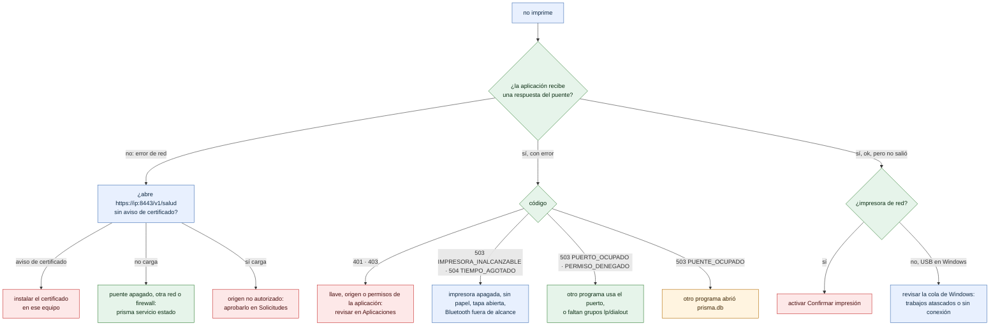

# Diagnóstico: «no imprime»

¿Por qué no salió el ticket y qué hacer? Árbol de decisión para soporte y para el dueño del negocio.

- La primera pregunta separa los problemas de **llegar** al puente (red, certificado, origen) de los de **imprimir** (impresora, permisos, base).
- Desde un navegador, un origen no aprobado se ve como error de red: si `/v1/salud` carga, casi siempre es eso.
- Con la advertencia `IMPRESORA_FUERA_DE_LINEA`, el ticket ya está en la impresora: se imprime al cerrar la tapa o poner papel. **No reenviar.**
- Las soluciones completas: [administracion/problemas-comunes.md](../administracion/problemas-comunes.md), [instalacion/problemas-comunes.md](../instalacion/problemas-comunes.md) e [integradores/problemas-comunes.md](../integradores/problemas-comunes.md).

**Fuentes en el código:**

- internal/conector/conector.go (códigos `Err…`)
- internal/conector/red.go
- internal/conector/usb_windows.go
- internal/servidor/servidor.go (`ResponderError`)
- internal/seguridad/autorizacion.go
- sdk/js/src/prisma.mjs (`_diagnosticarNavegador`)
- docs/referencia/codigos-de-error.md

**Última verificación:** PRISMA 0.1.0 (rama `develop`, commit `5f67e19`), 22 de octubre de 2026.
