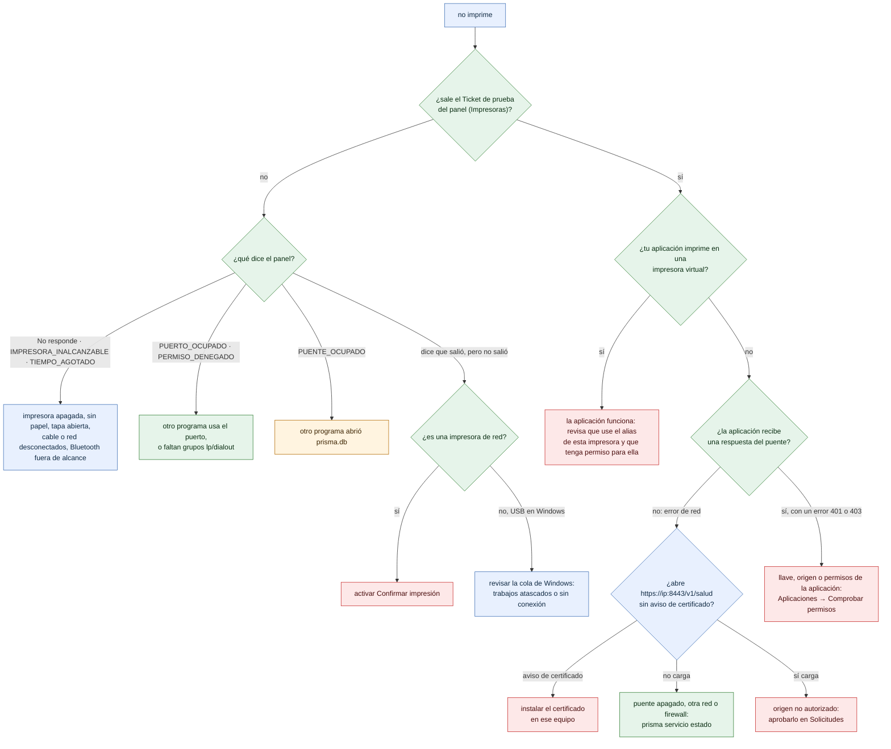

# Diagnóstico: «no imprime»

¿Por qué no salió el ticket y qué hacer? Árbol de decisión para soporte y para el dueño del negocio. El panel lo convierte en preguntas paso a paso en *Ayuda → Mi impresora no imprime*.

- La primera pregunta separa la **impresora** (si el ticket de prueba del panel no sale, el problema está entre el puente y la impresora) de la **aplicación**.
- Con la impresora bien, la [impresora virtual](../administracion/probar-sin-impresora.md) separa los problemas de la aplicación de los de esa impresora: si la aplicación imprime en la virtual, funciona, y lo que falta es el alias o el permiso.
- Desde un navegador, un origen no aprobado se ve como error de red: si `/v1/salud` carga, casi siempre es eso.
- Con la advertencia `IMPRESORA_FUERA_DE_LINEA`, el ticket ya está en la impresora: se imprime al cerrar la tapa o poner papel. **No reenviar.**

**Soluciones en el manual** (el panel enlaza cada respuesta del árbol con su línea; una prueba exige que cada final del árbol tenga la suya):

- `v`: [Probar sin impresora](../administracion/probar-sin-impresora.md)
- `c1`: [Confiar en el certificado](../instalacion/https-y-certificados.md#confiar-en-el-certificado)
- `c2`: [El panel o las aplicaciones no llegan desde otro equipo](../instalacion/problemas-comunes.md#el-panel-o-las-aplicaciones-no-llegan-desde-otro-equipo)
- `c3`: [Origen no autorizado](../integradores/problemas-comunes.md#origen-no-autorizado)
- `c4`: [¿Por qué mi app no puede imprimir?](../administracion/probar-impresion.md#por-qué-mi-app-no-puede-imprimir)
- `c5`: [La impresora no imprime](../administracion/problemas-comunes.md#la-impresora-no-imprime)
- `c6`: [Linux: la impresora USB no responde](../instalacion/problemas-comunes.md#linux-la-impresora-usb-no-responde-permiso-denegado)
- `c7`: [503 PUENTE_OCUPADO](../administracion/problemas-comunes.md#503-puente_ocupado)
- `c8`: [Dice «impreso», pero no salió](../administracion/problemas-comunes.md#dice-impreso-pero-no-salió-impresora-de-red)
- `c9`: [Windows dice que imprimió, pero no salió nada](../administracion/problemas-comunes.md#windows-dice-que-imprimió-pero-no-salió-nada)
- `c10`: [Elegir en qué impresoras imprime una aplicación](../administracion/tareas-frecuentes.md#elegir-en-qué-impresoras-imprime-una-aplicación)

**Fuentes en el código:**

- internal/conector/conector.go (códigos `Err…`)
- internal/conector/red.go
- internal/conector/usb_windows.go
- internal/servidor/servidor.go (`ResponderError`)
- internal/seguridad/autorizacion.go
- internal/admin/web/manual.js (`flujo`) e internal/admin/web/panel.js (`vistaNoImprime`)
- sdk/js/src/prisma.mjs (`_diagnosticarNavegador`)
- docs/referencia/codigos-de-error.md

**Última verificación:** PRISMA 0.2.0 en desarrollo (rama `develop`), 22 de octubre de 2026.
