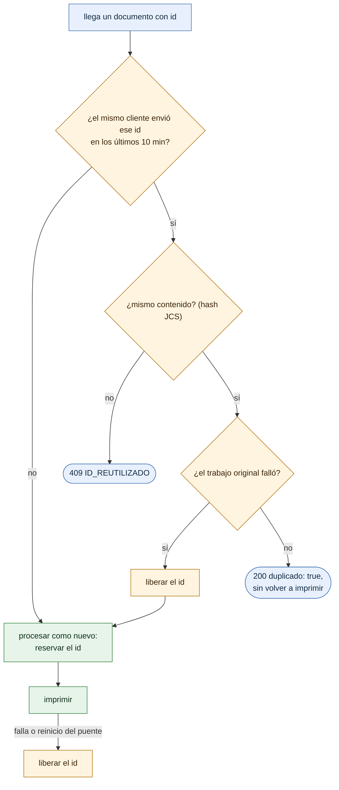

# Idempotencia

¿Qué responde el puente si llega el mismo `id`? Para integradores que implementan reintentos.

- Los `id` viven en `ids_recientes`, en la base: la ventana de 10 minutos sobrevive a los reinicios.
- Nunca se responde `ok: true` a un reintento de algo que no salió (invariante de CLAUDE.md).
- El SDK reintenta los errores de red con el **mismo** `id`; una aplicación propia debe hacer lo mismo.

**Fuentes en el código:**

- internal/almacen/ids_recientes.go (`Reservar`, `Liberar`, `VentanaIdempotencia`)
- internal/servidor/api.go (`responderSiRepetido`, `liberarSiFallo`, `finalizar`)
- internal/almacen/trabajos.go (`MarcarInterrumpidos`)

**Última verificación:** PRISMA 0.1.0 (rama `develop`, commit `5f67e19`), 22 de octubre de 2026.
