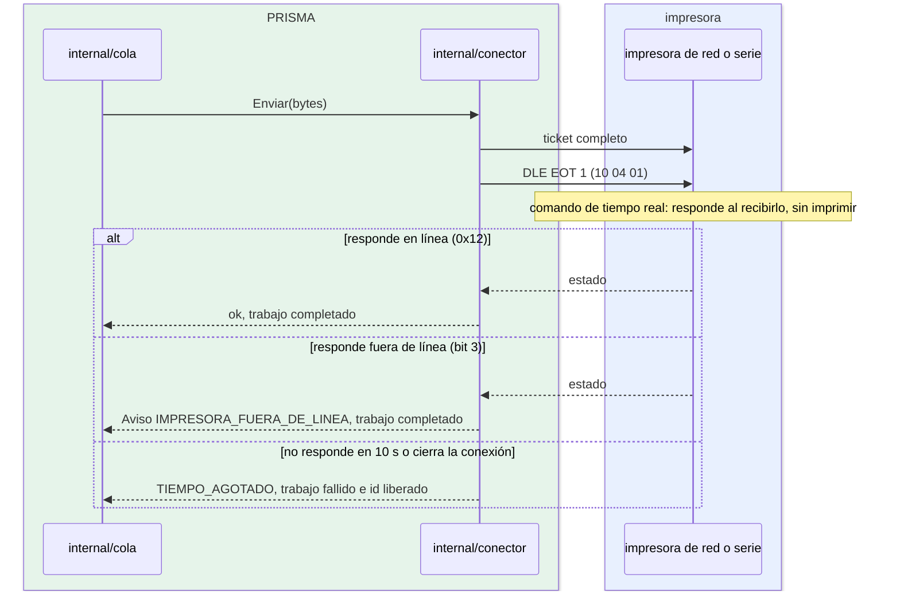

# Confirmar impresión

¿Cómo confirma el puente que el ticket llegó a una impresora de red o Bluetooth? Para instaladores que deciden si activarla e integradores que reciben su advertencia.

- Como la consulta viaja detrás del ticket, su respuesta confirma que el ticket completo llegó.
- «Fuera de línea» no es un fallo: la impresora ya tiene el ticket y lo imprimirá al resolverse; un reintento lo imprimiría dos veces ([ADR 0009](../adr/0009-trabajo-recibido-no-falla.md)).
- Está desactivada por defecto: algunas impresoras no responden a `DLE EOT`.
- La impresora virtual (`prisma dev impresora-virtual`) responde como una impresora en línea.

**Fuentes en el código:**

- internal/conector/conector.go (`consultaEstado`, `interpretarEstado`, `Aviso`, `TiempoConfirmacion`)
- internal/conector/red.go (`confirmar`)
- internal/conector/serie.go (`confirmar`)
- internal/cola/cola.go (`Resultado.Aviso`)
- internal/dev/virtual.go (`EstadoEnLinea`)

**Última verificación:** PRISMA 0.1.0 (rama `develop`, commit `5f67e19`), 22 de octubre de 2026.
