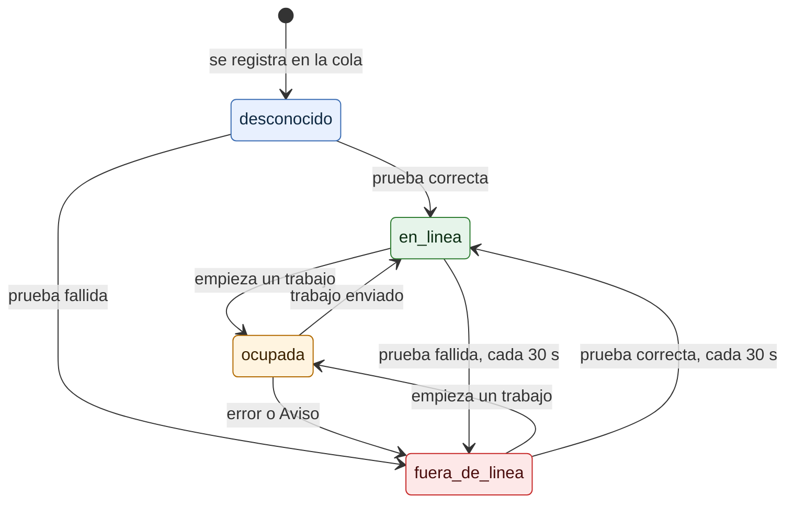

# Estados de una impresora

¿Cuándo una impresora está en línea, fuera de línea, ocupada o en estado desconocido? Para el dueño que ve el estado en el panel e integradores que leen `/v1/impresoras`.

- La misma goroutine de cada impresora imprime y prueba: nunca prueba mientras imprime.
- *Probar* abre la conexión (red, Bluetooth) o consulta el spooler (USB en Windows); no detecta falta de papel. Para eso, Confirmar impresión.
- Una impresora desactivada no está en la cola: el panel la muestra como *inactiva* y no aparece en `/v1/impresoras`.

**Fuentes en el código:**

- internal/cola/cola.go (`cambiar`, `probar`, `imprimir`, `Estado`)
- internal/conector/conector.go (`Conector.Probar`)
- internal/servidor/api.go (`impresoras`)

**Última verificación:** PRISMA 0.1.0 (rama `develop`, commit `5f67e19`), 22 de octubre de 2026.
