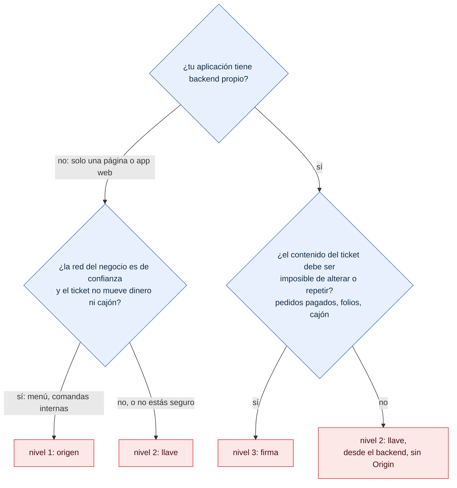

# Qué nivel de seguridad elegir

¿Qué nivel le conviene a mi aplicación? Para integradores antes de pedirle al dueño que la registre.

- El nivel 2 es el de fábrica y sirve en la mayoría de los casos.
- El nivel 1 no protege contra herramientas fuera del navegador: úsalo solo en redes de confianza.
- La explicación de cada rama: [integradores/niveles-de-seguridad.md](../integradores/niveles-de-seguridad.md).

**Fuentes en el código:**

- internal/almacen/clientes.go (`NivelOrigen`, `NivelLlave`, `NivelFirma`)
- internal/seguridad/autorizacion.go
- docs/integradores/niveles-de-seguridad.md

**Última verificación:** PRISMA 0.1.0 (rama `develop`, commit `5f67e19`), 22 de octubre de 2026.
