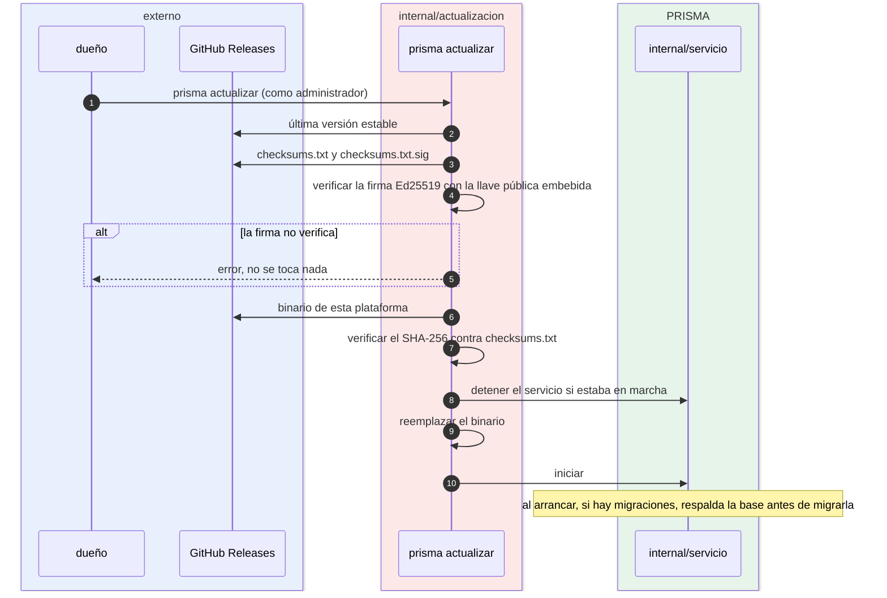

# Actualización

¿Cómo se actualiza el puente sin instalar nada que no venga del proyecto? Para administradores y auditores.

- El panel solo **avisa** de una versión nueva; nada se instala solo.
- Las versiones preliminares (`v1.2.0-rc.1`) no se ofrecen.
- Si no puede reemplazar el binario, deja el anterior y reinicia el servicio. En Windows, el anterior queda como `prisma.exe.old` hasta el siguiente arranque.
- Volver atrás: [operacion/actualizacion.md](../operacion/actualizacion.md#volver-a-la-versión-anterior).

**Fuentes en el código:**

- internal/actualizacion/actualizacion.go
- internal/actualizacion/reemplazar.go
- cmd/prisma/actualizar.go (`actualizarBinario`)
- internal/almacen/respaldo.go (`RespaldarSiHayMigraciones`)
- empaquetado/llave-releases.pub

**Última verificación:** PRISMA 0.1.0 (rama `develop`, commit `5f67e19`), 22 de octubre de 2026.
