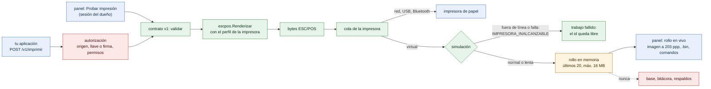

# Impresora virtual

¿Qué recibe una impresora virtual y dónde queda lo que imprime? Para dueños, instaladores e integradores que prueban sin papel.

- Hasta la cola, una impresora virtual y una de papel siguen el mismo camino: la misma autorización, la misma validación y el mismo renderizador con su perfil (ancho, columnas, página de códigos, capacidades). Por eso los bytes del rollo son exactamente los que recibiría una impresora real, y el `.bin` se puede revisar con `prisma dev decodificar`.
- Lo que prueba: el documento, la autorización de la aplicación, cómo queda el ticket y el manejo de errores de la aplicación. Lo que no prueba: el cable, la red, el papel o la página de códigos que la impresora física entiende de verdad.
- «Probar impresión» entra al mismo camino después de la autorización: la sesión del panel reemplaza al origen y la llave, y el trabajo queda a nombre de «Panel».
- La simulación responde con códigos que la API v1 ya informa. Un ticket que falla no llega al rollo y su `id` queda libre, como en cualquier trabajo fallido ([24-idempotencia.md](24-idempotencia.md)).
- El rollo vive solo en la memoria del puente: se borra al reiniciar o con *Vaciar rollo*, y nunca pasa por la base, la bitácora ni los respaldos (lo verifican `TestImpresoraVirtualDePrincipioAFin` y `TestProbarImpresionNoGuardaElContenido`).
- Cómo usarla, paso a paso: [administracion/probar-sin-impresora.md](../administracion/probar-sin-impresora.md).

**Fuentes en el código:**

- internal/conector/virtual.go (`Virtual`, `Rollos`, `RollosVirtuales`)
- internal/servidor/api.go (`imprimir`)
- internal/admin/pruebas.go (`imprimirDocumentoPrueba`)
- internal/admin/virtual.go (`listarRollo`, `imagenTicket`, `binTicket`, `trazaTicket`)
- internal/dev/raster.go (`Rasterizar`)
- internal/servidor/virtual_test.go (`TestImpresoraVirtualDePrincipioAFin`)

**Última verificación:** PRISMA 0.2.0 en desarrollo (rama `develop`), 22 de octubre de 2026.
