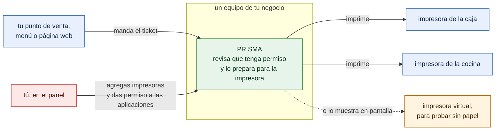

# Cómo funciona PRISMA

¿Qué hace PRISMA en el negocio, sin tecnicismos? Para el dueño. La versión técnica, con los componentes y los puertos, es [01-contexto.md](01-contexto.md).

- PRISMA vive en un equipo de tu negocio y funciona sin Internet. Tus aplicaciones no necesitan saber cómo está conectada cada impresora: la eligen por su nombre corto (`caja`, `cocina`).
- Ninguna aplicación imprime sin tu permiso: la autorizas en *Aplicaciones* o apruebas su solicitud en *Solicitudes*.
- PRISMA no guarda lo que imprimes; solo si salió bien o qué falló.

**Fuentes en el código:**

- internal/servidor/api.go (`imprimir`)
- internal/seguridad/autorizacion.go
- internal/conector/conector.go (`Nuevo`)
- internal/admin/admin.go (`Handler`)

**Última verificación:** PRISMA 0.2.0 en desarrollo (rama `develop`), 22 de octubre de 2026.
