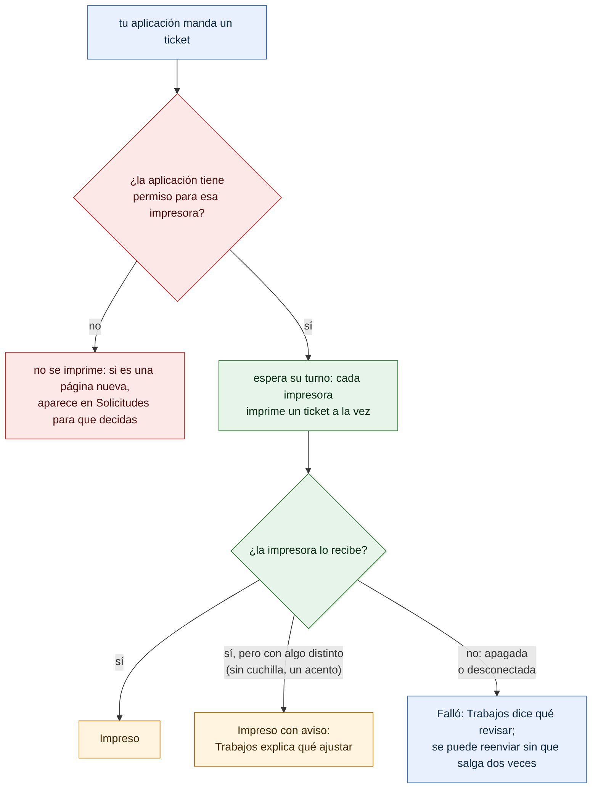

# El viaje de un ticket

¿Por dónde pasa un ticket y qué significa lo que muestra *Trabajos*? Para el dueño. La versión técnica, con los estados y los códigos, es [08-ciclo-vida-trabajo.md](08-ciclo-vida-trabajo.md).

- «Impreso» quiere decir que la impresora recibió el ticket. Si la impresora avisa que tiene la tapa abierta o no tiene papel, queda «Impreso con aviso» y sale en cuanto lo resuelves: no hace falta reenviarlo.
- Un ticket que falló no salió, así que la aplicación puede volver a mandarlo. Y si reenvía uno que sí salió (el mismo ticket, con su mismo identificador), PRISMA no lo imprime otra vez.
- PRISMA guarda el resultado de cada ticket los días que indiques en *Ajustes*, nunca su contenido.

**Fuentes en el código:**

- internal/servidor/api.go (`imprimir`, `finalizar`)
- internal/cola/cola.go
- internal/almacen/trabajos.go
- internal/seguridad/autorizacion.go (`VerificarPermisos`)

**Última verificación:** PRISMA 0.2.0 en desarrollo (rama `develop`), 22 de octubre de 2026.
