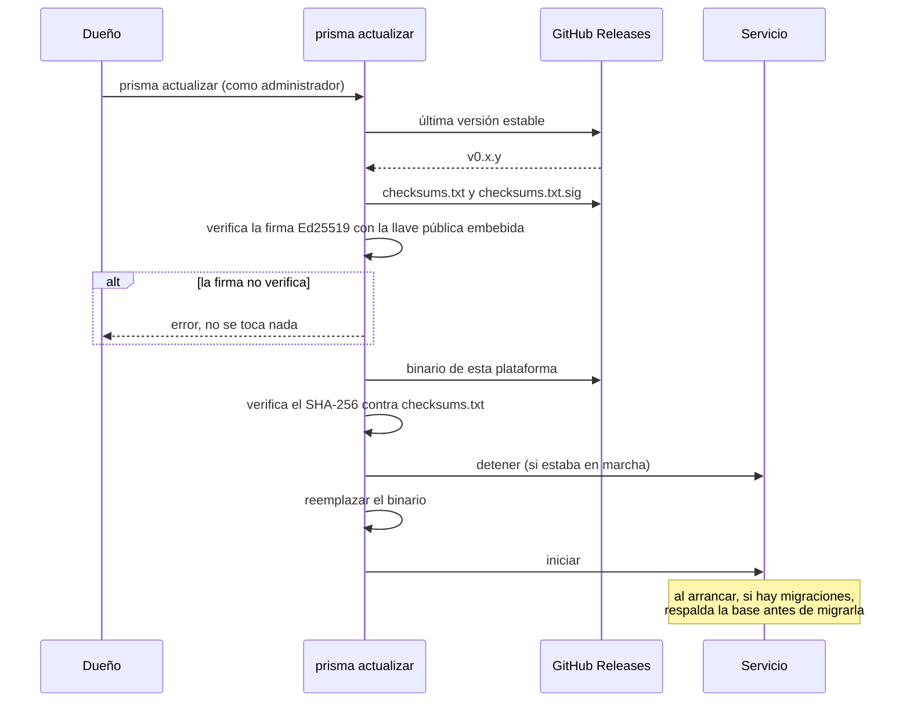

# Actualización

¿Cómo se actualiza el puente sin riesgo?

El panel solo avisa de la versión nueva; nunca instala nada solo. Ver [ADR 0012](../adr/0012-actualizaciones-firmadas.md).

**Basado en:**

- internal/actualizacion/actualizacion.go
- internal/actualizacion/reemplazar.go
- cmd/prisma/actualizar.go (`actualizarBinario`)
- internal/almacen/respaldo.go (`RespaldarSiHayMigraciones`)
- empaquetado/llave-releases.pub
