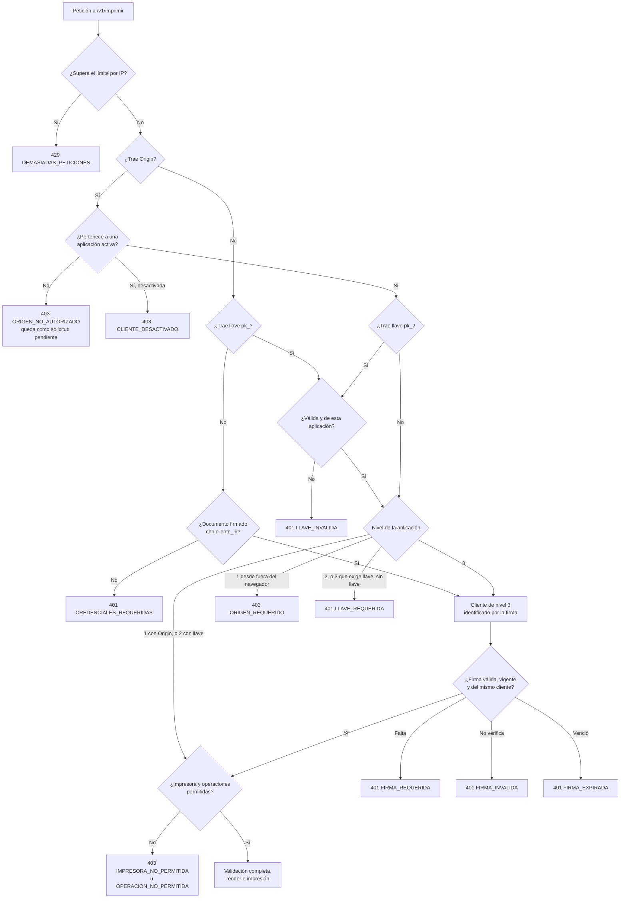

# Cómo decide el puente si acepta una petición

¿Se acepta esta petición y con qué código se rechaza?

Entre la identificación y la firma también se aplican el límite por cliente y las comprobaciones de tamaño, JSON y versión; ver [secuencia-imprimir.md](secuencia-imprimir.md).

**Basado en:**

- internal/seguridad/autorizacion.go (`Identificar`, `VerificarDocumento`, `VerificarPermisos`)
- internal/seguridad/firma.go
- internal/servidor/api.go (`identificar`, `autorizarDocumento`)
