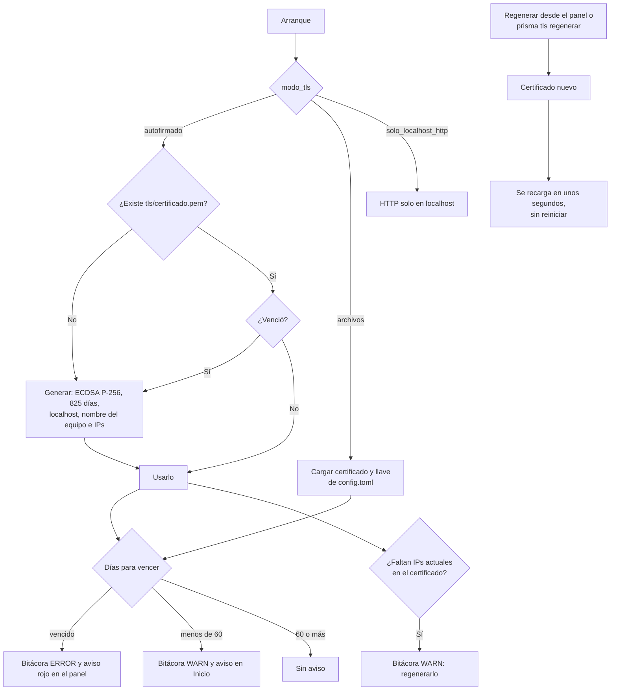

# Ciclo del certificado

¿Qué hace el puente con su certificado al arrancar y mientras corre?

Después de regenerarlo, hay que volver a instalarlo en cada equipo que imprime.

**Basado en:**

- internal/servidor/tls.go (`CargarAutofirmado`, `Vencimiento`, `AvisoVencimiento`, `vigenciaAutofirmado`)
- internal/servidor/escuchar.go (`avisarVencimiento`)
- internal/admin/ajustes.go (`avisoCertificado`, `regenerarTLS`)
- cmd/prisma/tls.go
