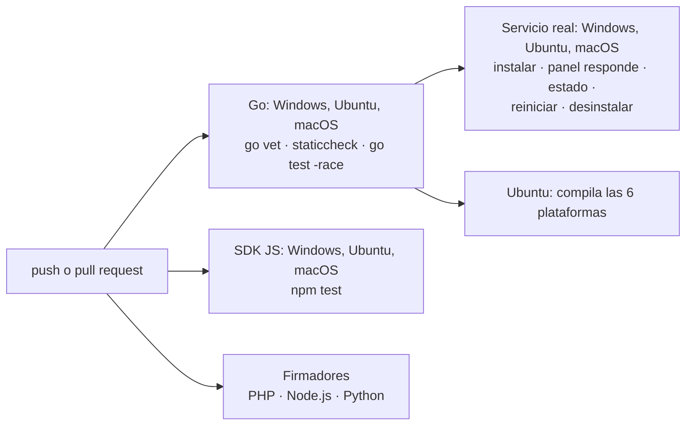

# Integración continua

¿Qué se comprueba en cada push a `main` o `develop` y en cada pull request?

Las pruebas de `go test` incluyen las de la documentación (`go test ./docs`): rutas de la API, códigos de error y enlaces.

**Basado en:**

- .github/workflows/ci.yml
