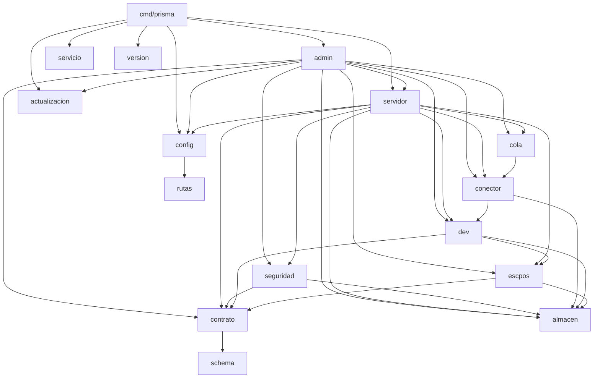

# Componentes

¿Qué paquete depende de cuál? Solo dependencias entre paquetes del proyecto, según `go list ./...`.

`cmd/prisma` importa además, directamente, todos los paquetes de `internal/`; el diagrama muestra solo las aristas que explican la estructura. La tabla completa está en [arquitectura/componentes.md](../arquitectura/componentes.md).

**Basado en:**

- `go list -f '{{.ImportPath}} {{.Imports}}' ./...`
- cmd/prisma
- internal/*
- schema
