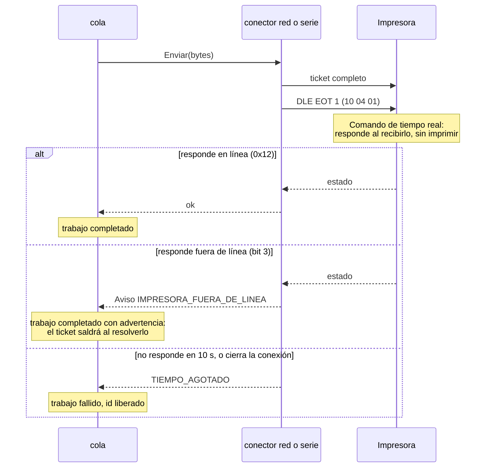

# Confirmar impresión

¿Cómo confirma el puente que el ticket llegó a la impresora?

Solo en impresoras de red y Bluetooth con la opción activada. Ver [instalacion/impresoras.md](../instalacion/impresoras.md#confirmar-impresión) y [ADR 0009](../adr/0009-trabajo-recibido-no-falla.md).

**Basado en:**

- internal/conector/red.go (`confirmar`)
- internal/conector/serie.go (`confirmar`)
- internal/conector/conector.go (`consultaEstado`, `interpretarEstado`, `Aviso`, `TiempoConfirmacion`)
- internal/cola/cola.go (`Resultado.Aviso`)
- internal/dev/virtual.go (`EstadoEnLinea`)
