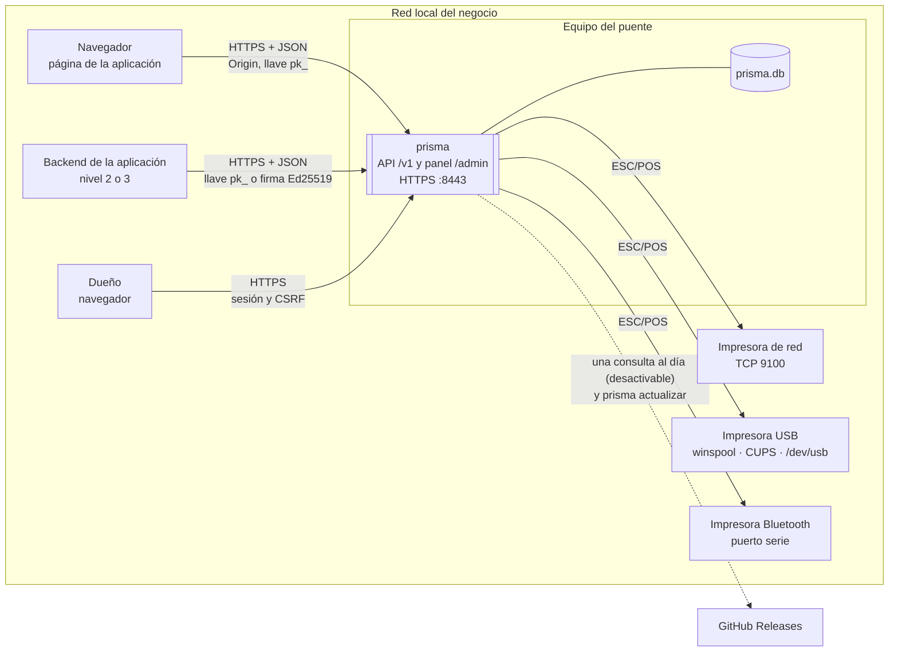

# Contexto del sistema

¿Quién habla con el puente y por dónde? Nada más sale a Internet.

**Basado en:**

- internal/servidor/servidor.go (`Handler`)
- internal/admin/admin.go
- internal/conector/*
- internal/actualizacion/*
