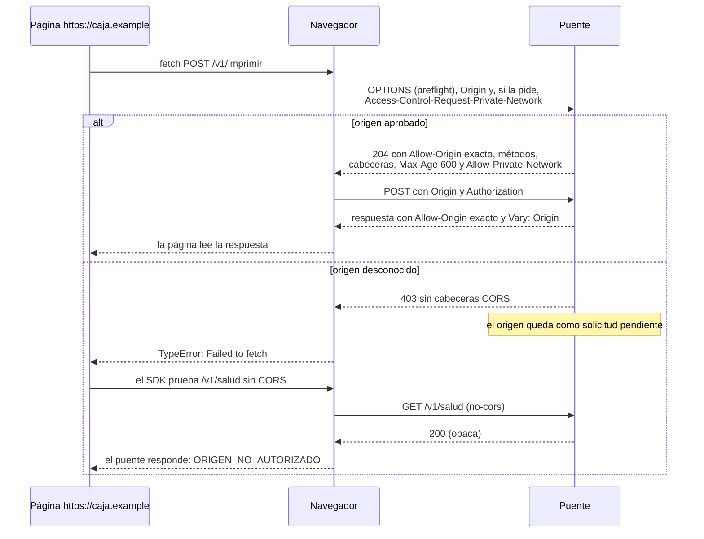

# CORS y red local

¿Por qué el navegador a veces no ve la respuesta del puente?

Un 429 del límite por IP también lleva las cabeceras CORS, para que la página vea `DEMASIADAS_PETICIONES` y no un error de red.

**Basado en:**

- internal/servidor/servidor.go (`preflight`, `permitirCORS`, `limitarIP`)
- internal/servidor/api.go (`salud`)
- sdk/js/src/prisma.mjs (`_diagnosticarNavegador`)
