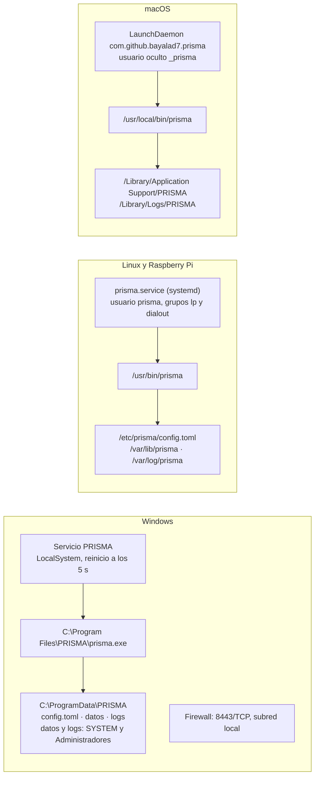

# Despliegue por sistema

¿Cómo queda instalado el puente en cada sistema?

La tabla completa de rutas está en [operacion/README.md](../operacion/README.md#dónde-está-cada-cosa).

**Basado en:**

- internal/servicio/servicio.go
- internal/servicio/plantillas.go
- internal/servicio/sistema_windows.go
- internal/servicio/sistema_linux.go
- internal/servicio/sistema_darwin.go
- internal/rutas/*
- empaquetado/*
