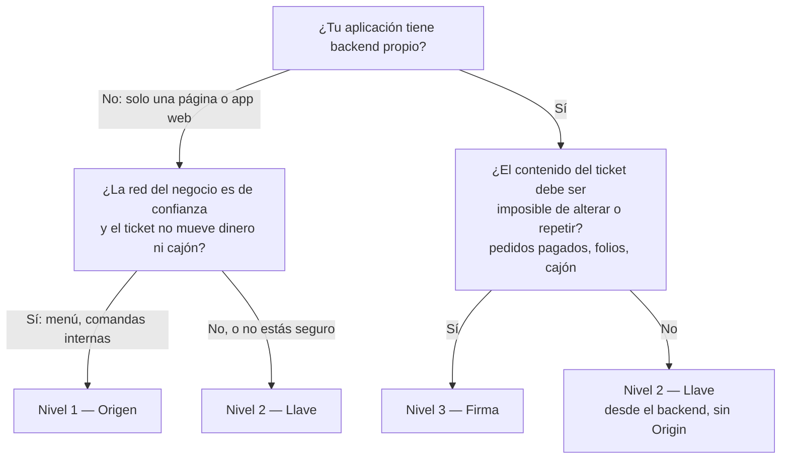

# Qué nivel de seguridad elegir

¿Qué nivel le conviene a mi aplicación?

La explicación de cada rama está en [integradores/niveles-de-seguridad.md](../integradores/niveles-de-seguridad.md).

**Basado en:**

- docs/integradores/niveles-de-seguridad.md
- internal/almacen/clientes.go (`NivelOrigen`, `NivelLlave`, `NivelFirma`)
