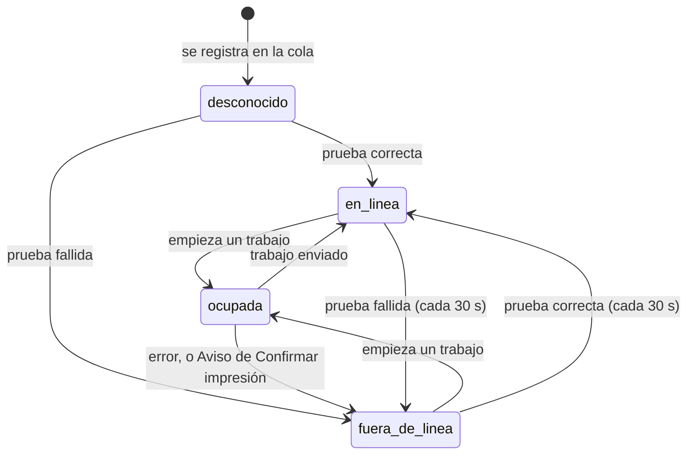

# Estados de una impresora

¿Cuándo una impresora está en línea, fuera de línea, ocupada o en estado desconocido?

La misma goroutine de cada impresora imprime y prueba, así que nunca prueba mientras imprime. Una impresora desactivada se muestra como *inactiva* en el panel y no aparece en `/v1/impresoras`.

**Basado en:**

- internal/cola/cola.go (`cambiar`, `probar`, `imprimir`)
- internal/conector/conector.go (`Conector.Probar`)
