# Estados de un trabajo

¿Por qué estados pasa un trabajo?

```mermaid
stateDiagram-v2
    [*] --> encolado: documento aceptado, id reservado
    encolado --> imprimiendo: solo con prisma imprimir (CLI)
    encolado --> completado: la impresora lo recibió
    encolado --> fallido: error de la impresora, cola cerrada
    imprimiendo --> completado
    imprimiendo --> fallido
    encolado --> fallido: el puente se reinició (PUENTE_REINICIADO)
    imprimiendo --> fallido: el puente se reinició (PUENTE_REINICIADO)
    completado --> [*]
    fallido --> [*]: el id se libera; el reintento se imprime

    note right of completado
        Puede llevar advertencias, por ejemplo
        IMPRESORA_FUERA_DE_LINEA
    end note
```

En 0.1.0, los trabajos que llegan por la API pasan directo de `encolado` a `completado` o `fallido`: la cola del servicio no marca `imprimiendo` (solo lo hace `prisma imprimir`). Ver la discrepancia D-22 del [plan](../PLAN-DOCUMENTACION.md).

**Basado en:**

- internal/almacen/trabajos.go (`Crear`, `MarcarImprimiendo`, `Finalizar`, `MarcarInterrumpidos`)
- internal/servidor/api.go (`finalizar`)
- cmd/prisma/ejecutar.go
- cmd/prisma/imprimir.go
