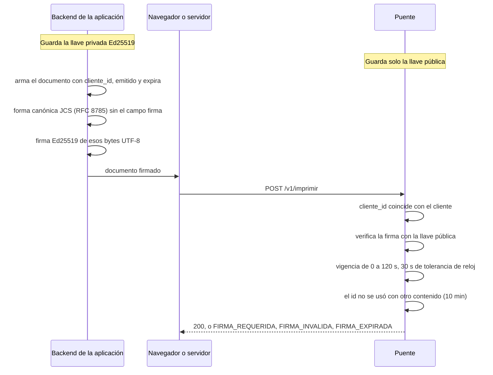

# Firma de nivel 3

¿Quién firma qué en el nivel 3, y qué comprueba el puente?

La guía para implementarlo está en [integradores/firmar-documentos.md](../integradores/firmar-documentos.md).

**Basado en:**

- internal/seguridad/firma.go (forma canónica con `gowebpki/jcs`)
- internal/contrato/reglas.go (`VigenciaMaxima`)
- sdk/firmadores/*
- testdata/vector-firma/
