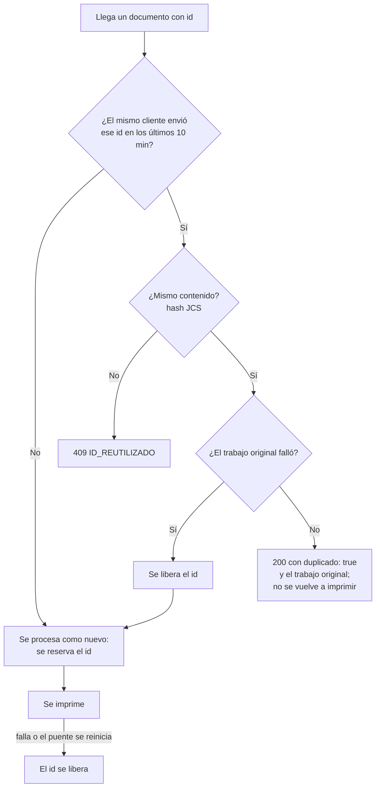

# Idempotencia

¿Qué responde el puente si llega el mismo `id`?

Los `id` viven en la base: la ventana de 10 minutos sobrevive a los reinicios.

**Basado en:**

- internal/almacen/ids_recientes.go (`Reservar`, `Liberar`, `VentanaIdempotencia`)
- internal/servidor/api.go (`responderSiRepetido`, `liberarSiFallo`, `finalizar`)
- internal/almacen/trabajos.go (`MarcarInterrumpidos`)
