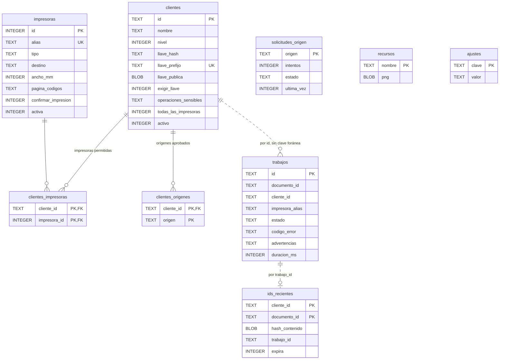

# Modelo de datos

¿Qué guarda la base y cómo se relacionan las tablas?

Solo se muestran las columnas principales. `trabajos` e `ids_recientes` no tienen claves foráneas a propósito: el historial se conserva aunque se borre la aplicación o la impresora. `trabajos` **nunca** guarda el contenido del ticket.

**Basado en:**

- internal/almacen/migraciones/0001_inicial.sql
- internal/almacen/migraciones/0002_llaves_argon2id.sql
- internal/almacen/migraciones/0003_nivel2_sin_llave.sql
- internal/almacen/migraciones/0004_confirmar_impresion.sql
