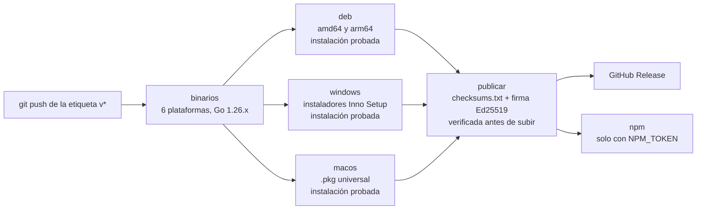

# Publicación de una versión

¿Qué hace el workflow al empujar una etiqueta `v*`?

El proceso para el responsable está en [desarrollo/publicar.md](../desarrollo/publicar.md).

**Basado en:**

- .github/workflows/release.yml
- Makefile
- build.ps1
- empaquetado/*
