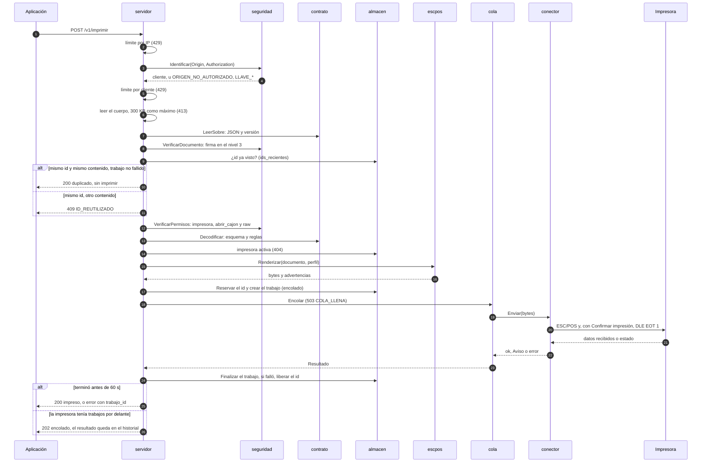

# Secuencia de `POST /v1/imprimir`

¿Qué pasa, en orden, desde que llega la petición hasta la respuesta?

Nada costoso (esquema completo, imágenes, render) ocurre antes de identificar al cliente y comprobar sus permisos.

**Basado en:**

- internal/servidor/api.go (`autorizarDocumento`, `imprimir`, `responderSiRepetido`, `liberarSiFallo`, `finalizar`)
- internal/servidor/servidor.go (`limitarIP`)
- internal/seguridad/autorizacion.go
- internal/contrato/validar.go
- internal/escpos/renderizar.go
- internal/cola/cola.go
- internal/conector/*
