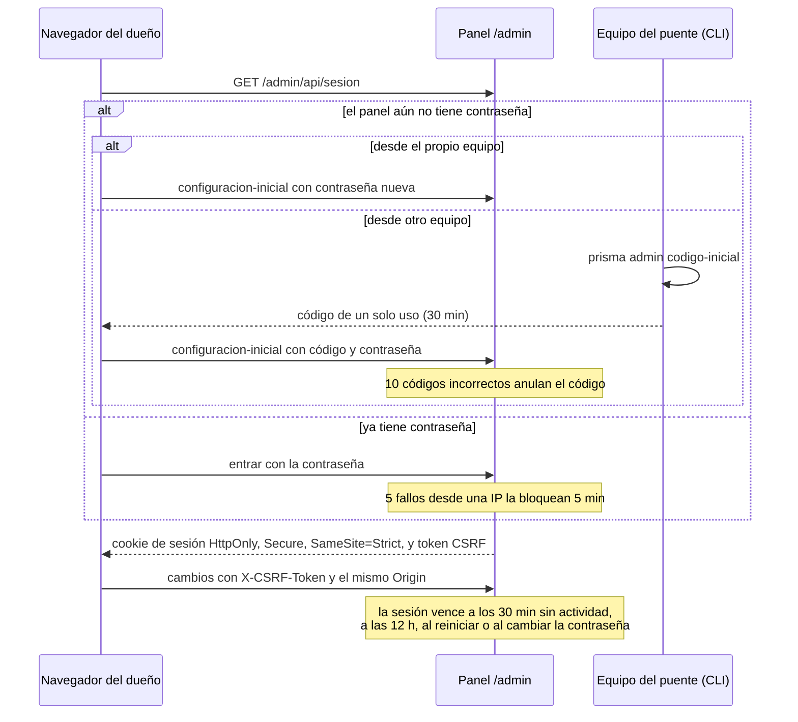

# Sesión del panel

¿Cómo se entra al panel y cómo se protege la sesión?

**Basado en:**

- internal/admin/sesiones.go
- internal/admin/admin.go (`sesion`, `entrar`, `configuracionInicial`, `conSesion`)
- cmd/prisma/admin.go
